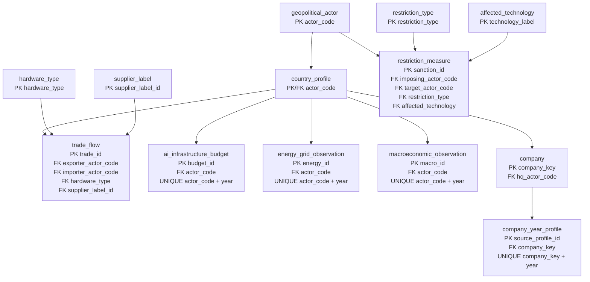
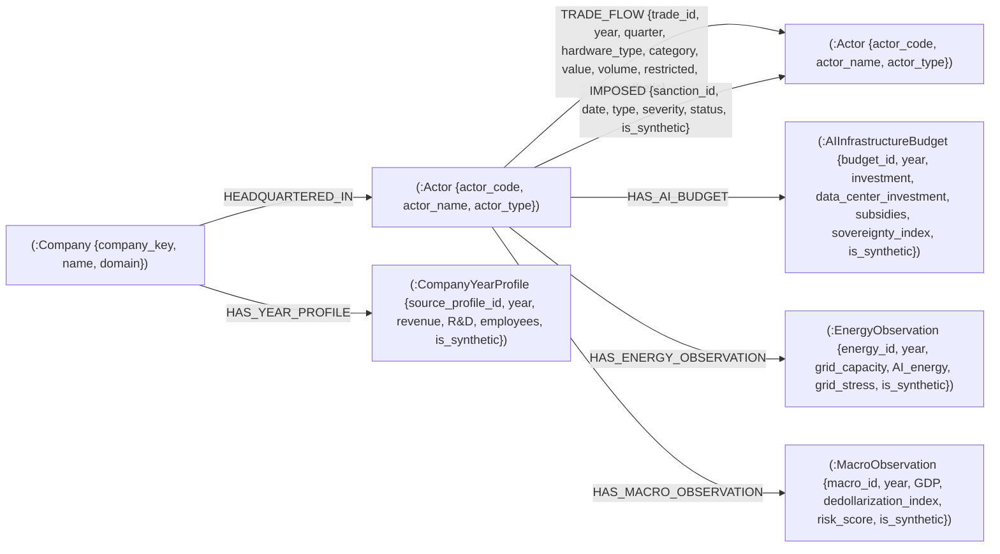
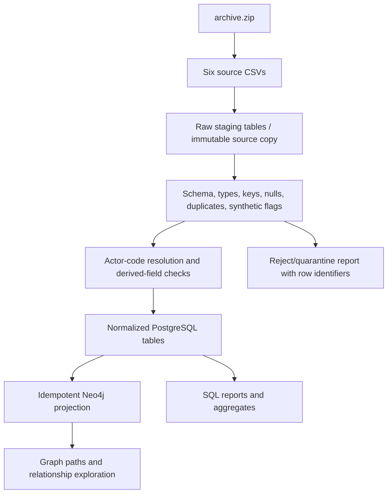
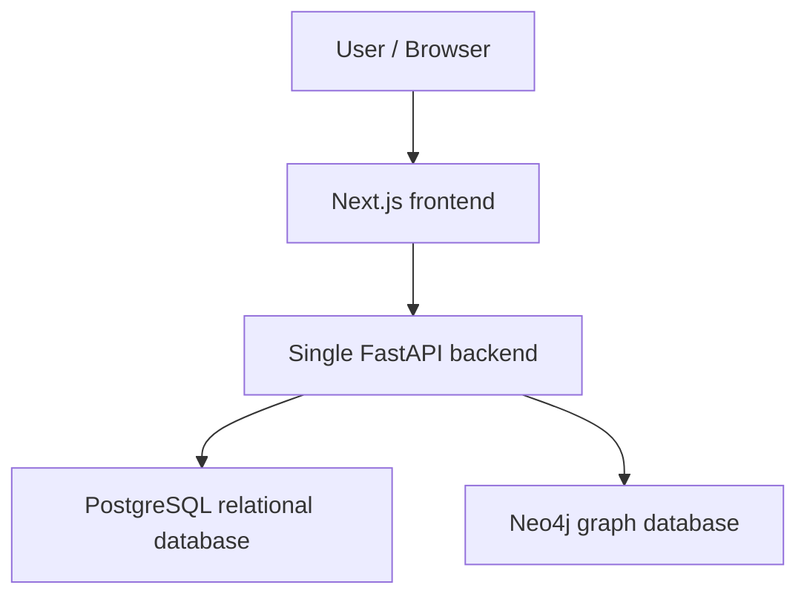
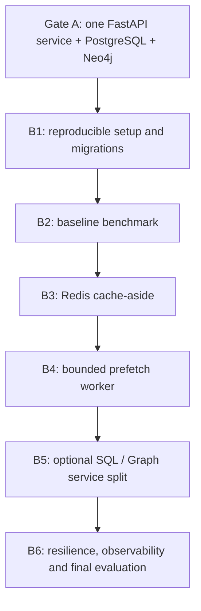
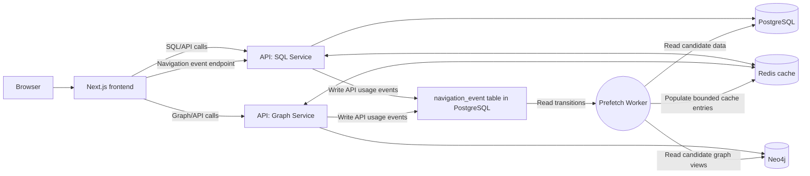

# RITEN-GRAPH
## Realpolitik in Technology and Economic Notation Graph

**Project guide and implementation source of truth**  
**Project type:** Geopolitical Supply-Chain Intelligence Platform  
**Database architecture:** PostgreSQL + Neo4j; Next.js; FastAPI; later Redis and a bounded prefetch worker  
**Planning horizon:** 8–12 weeks, adjustable  
**Guide status:** Consolidated directly from the assignment PDF, the supplied `archive.zip`, and the decisions recorded in this conversation. This file is the canonical Markdown version; Mermaid diagrams render in a Mermaid-compatible Markdown viewer.

---

## How to use this guide

This guide is intentionally organized around four things: **Day 0**, **Data foundation**, **Gate A**, and **Gate B**. Work in that order. Gate A is complete only when the original assignment requirements are demonstrated. Gate B adds systems engineering only after there is a correct working baseline and a measured performance baseline.

Treat statements in this document as one of four types:

- **Assignment requirement:** explicitly stated in `DBMS Level 3 Project Requirements.pdf`.
- **Archive fact:** observed in the supplied CSV files or verified in the first-pass data audit.
- **Design decision:** the recommended model or implementation choice for RITEN-GRAPH.
- **Optional experiment:** a later feature that must earn its place through evidence.

Do not use old report examples as source facts. This guide replaces their unsupported sample filenames, invented row examples, unsupported company-to-trade joins, and the out-of-scope sharding/custom distributed query-coordinator plan.

## Executive summary

RITEN-GRAPH explores how semiconductor supply-chain flows, technology restrictions, national AI infrastructure investments, energy-grid constraints, macroeconomic indicators, and technology-company profiles relate to one another. It is deliberately more than a CRUD application: its core use cases are cross-domain comparison, aggregate reporting, restrictions and exposure analysis, and graph traversal of country-to-country relationships.

PostgreSQL is the system of record for normalized entities, source observations, constraints, joins, and analytical reports. Neo4j is used for graph-shaped questions such as trade paths, relationships between geopolitical actors, restriction networks, and company headquarters. A single FastAPI service and a simple Next.js interface are the Gate A baseline. Redis caching, a bounded prefetch worker, and a split SQL/Graph service deployment are Gate B extensions, introduced one at a time and evaluated against baseline behavior.

The archive contains six CSV files and 7,281 records spanning 2015–2025. All six include an `is_synthetic` flag. The data is historical/static and partly synthetic, so the application must expose source/provenance limitations and must not claim live geopolitical monitoring. The first-pass audit found no blank fields and no exact duplicate rows, but there are important modeling constraints: there is no country-master file; company IDs change across annual profiles; and supplier labels do not safely join to company records.

---

# 1. Day 0 — tools, setup and foundational knowledge

Day 0 does not mean mastering every topic before writing code. It means installing the minimum toolchain, learning basic operations, and knowing what must be studied just before each implementation phase.

## 1.1 Required toolchain

| Tool / technology | Day 0 readiness target | Used for | Learn deeper in |
|---|---|---|---|
| Git + GitHub | Clone/init a repo, branch, status, diff, commit, push, pull, ignore generated files | Reproducible work and contribution history | Every phase |
| Shell / terminal | Navigate directories, inspect files, run scripts, inspect logs, use `grep`, `head`, `wc`, `unzip` or equivalents | Dataset inspection and debugging | Day 0 onward |
| Python + virtual environments | Create a project venv, install pinned dependencies, run a script, handle exceptions, use CSV/JSON | ETL, FastAPI, tests and prefetch worker | Gate A; worker later |
| PostgreSQL + `psql` | Connect to DB, create table, insert/select, keys/constraints, joins and aggregates | Relational system of record | Data foundation and Gate A |
| Neo4j + Cypher | Create nodes, match patterns, define uniqueness constraints, traverse relationships | Graph projection and graph queries | Data foundation and Gate A |
| Node.js + npm | Install project dependencies, run a development server and tests | Next.js frontend | Gate A |
| JavaScript / TypeScript basics | Objects, arrays, async/await, modules, types, JSON and fetch | Browser-to-API integration | Before building pages |
| Next.js | Create pages/components and call the API | Required web interface | Gate A |
| FastAPI + Pydantic | Define routes, validate input, return JSON, handle exceptions | Backend/API | Gate A |
| Docker + Docker Compose | Understand images, containers, ports, volumes, environment variables and service names | Reproducible local stack | Gate B unless the team chooses it earlier for convenience |
| `pytest` + API test client | Write an assertion, run tests and read a failure | Regression and integration tests | Gate A |
| Browser devtools + `curl` | Inspect requests, status codes, payloads, timing and console errors | End-to-end debugging | Gate A |
| Mermaid-compatible Markdown viewer | Render Mermaid diagrams and edit source diagrams | Keep the system documentation readable | Day 0 onward |
| Redis client / `redis-cli` | Not required on Day 0; learn `GET`, `SET`, TTL and expiry just before using Redis | Cache-aside and prefetch cache | Gate B |

Use stable, mutually compatible dependency versions and pin them in the project. Do not upgrade major versions halfway through a gate. Use a local Python virtual environment and `.env` for local secrets; commit `.env.example` with placeholder values but never credentials.

## 1.2 Minimum concepts to understand before Gate A

1. **Relational database:** entity, tuple/row, attribute/column, candidate key, primary key, foreign key, uniqueness, `NOT NULL`, `CHECK`, normalization, join, aggregation, index, transaction.
2. **ER-to-relational translation:** entity becomes a table; a one-to-many relationship normally becomes a foreign key on the many side; a many-to-many relationship normally needs an associative table; weak/optional relationships need explicit cardinality and nullability decisions.
3. **Property graph:** nodes represent entities, relationships represent links or event flows, properties hold attributes. A graph edge must represent a relationship supported by the source data, not merely a plausible real-world relationship.
4. **HTTP and JSON:** frontend sends a request, backend validates it, queries a database, maps results to a response and returns a status code.
5. **Data lineage:** preserve source IDs, source filenames, source references, and `is_synthetic`. Never discard provenance while cleaning data.
6. **Security basics:** parameterized SQL/Cypher where applicable, validated inputs, hashed passwords, least privilege, secrets in environment variables, no database credentials in frontend code.
7. **Testing mindset:** a query that returns rows is not automatically correct. Compare known counts, enforce key invariants, test bad input and dependency failure, and preserve reproducible expected results.

## 1.3 Day 0 exercises and mastery checks

Do these in your own repository before asking for implementation help.

- Create a Git repo with `README.md`, `.gitignore`, `docs/`, `backend/`, `frontend/`, `data/`, `tests/` and `scripts/`. Commit the initial structure.
- List archive members before extracting: `unzip -l archive.zip`. Extract to a data directory that is excluded from Git if required by course/data licensing.
- Write a small inspection script that prints each CSV's row count, headers, data types, null counts, exact duplicate count, key candidates and `is_synthetic` counts. Do not build the canonical schema from assumed filenames.
- In PostgreSQL, create a small table with a primary key, a foreign key and a `CHECK` constraint; show one accepted and one rejected insert.
- In Neo4j, create two actor nodes and one directed relationship, then query a one-hop and a two-hop path.
- Write one minimal FastAPI route with typed input validation; test a valid request and invalid request using `pytest`.
- Create a Next.js page that requests one endpoint and clearly handles loading, empty and error states.
- Render the Mermaid code in this guide using a compatible preview. If a diagram fails to render, fix the source instead of replacing it with a pasted screenshot.

**Day 0 completion check:** you can explain how an HTTP request travels from Next.js through FastAPI to PostgreSQL or Neo4j; you can inspect the archive without modifying it; and you can run the project tests from a clean checkout.

## 1.4 Official learning references

Use primary documentation and work through only the sections needed for the next milestone.

- PostgreSQL tutorial and SQL reference: https://www.postgresql.org/docs/current/tutorial.html and https://www.postgresql.org/docs/current/
- Neo4j Cypher and modelling: https://neo4j.com/docs/getting-started/ and https://neo4j.com/docs/cypher-manual/current/
- FastAPI tutorial: https://fastapi.tiangolo.com/tutorial/
- Next.js documentation: https://nextjs.org/docs
- Python tutorial: https://docs.python.org/3/tutorial/
- Git book: https://git-scm.com/book/en/v2
- Docker Compose: https://docs.docker.com/compose/
- Redis documentation: https://redis.io/docs/latest/
- Pytest: https://docs.pytest.org/en/stable/
- OWASP Cheat Sheet Series: https://cheatsheetseries.owasp.org/
- Mermaid flowcharts: https://mermaid.js.org/syntax/flowchart.html

---

# 2. Data foundation — what is actually in the archive

## 2.1 Verified archive inventory

The archive contains exactly these six CSV files. The row counts and first-pass quality checks below were rechecked against the uploaded archive for this guide.

| File | Rows | Columns | Synthetic rows | Purpose |
|---|---:|---:|---:|---|
| `01_semiconductor_trade_flows.csv` | 5,656 | 23 | 1,008 (17.8%) | Quarterly semiconductor/hardware trade observations |
| `02_trade_sanctions_export_controls.csv` | 987 | 19 | 945 (95.7%) | Restrictions, sanctions and export-control measures |
| `03_national_ai_infrastructure_budgets.csv` | 132 | 22 | 24 (18.2%) | Annual national AI investment and infrastructure budget measures |
| `04_energy_grid_capacity.csv` | 132 | 22 | 24 (18.2%) | Annual energy-grid capacity and AI data-centre energy measures |
| `05_macroeconomic_indicators.csv` | 132 | 21 | 24 (18.2%) | Annual macroeconomic and technology-economy indicators |
| `06_company_profiles.csv` | 242 | 14 | 44 (18.2%) | Annual company observations for 22 companies |
| **Total** | **7,281** | — | **2,069 (28.4%)** | — |

Every file spans 2015–2025. First-pass inspection found no blank fields and no exact duplicate rows. This does not prove all business rules are consistent. The audit must also test allowed values, source consistency, key uniqueness, foreign-key coverage and redundant columns.

## 2.2 Source columns by file

These lists are the raw archive contract. Raw staging must retain them exactly, even if the normalized target schema derives or relocates some attributes.

### `01_semiconductor_trade_flows.csv`

`trade_id`, `year`, `quarter`, `year_quarter`, `exporter_country_code`, `exporter_country`, `exporter_region`, `importer_country_code`, `importer_country`, `importer_region`, `hardware_type`, `hardware_category`, `volume_units`, `trade_value_usd_millions`, `primary_supplier`, `trade_route`, `export_control_applied`, `restriction_factor`, `geopolitical_sensitivity`, `geo_risk_score_exporter`, `geo_risk_score_importer`, `data_source`, `is_synthetic`.

### `02_trade_sanctions_export_controls.csv`

`sanction_id`, `date_implemented`, `year`, `month`, `imposing_country_code`, `imposing_country`, `imposing_region`, `target_country_code`, `target_country`, `restriction_type`, `affected_technology`, `severity_level`, `description`, `source_reference`, `is_retaliatory`, `multilateral`, `status`, `economic_impact_usd_bn_est`, `is_synthetic`.

### `03_national_ai_infrastructure_budgets.csv`

`budget_id`, `country_code`, `country`, `region`, `year`, `total_ai_investment_usd_bn`, `public_investment_pct`, `private_investment_pct`, `public_investment_usd_bn`, `private_investment_usd_bn`, `datacenter_investment_usd_bn`, `semiconductor_subsidies_usd_bn`, `swf_allocation_usd_bn`, `ai_workforce_investment_usd_bn`, `strategic_initiative`, `national_supercomputer_projects`, `foreign_tech_restrictions_active`, `geopolitical_risk_score`, `ai_sovereignty_index`, `alliance_bloc`, `data_source`, `is_synthetic`.

### `04_energy_grid_capacity.csv`

`energy_id`, `country_code`, `country`, `region`, `year`, `total_grid_capacity_gw`, `ai_datacenter_energy_twh`, `pct_grid_used_by_ai`, `renewable_energy_pct`, `non_renewable_energy_pct`, `coal_pct`, `natural_gas_pct`, `nuclear_pct`, `solar_wind_pct`, `hydro_pct`, `energy_constraint_level`, `planned_expansion_gw`, `ai_grid_stress_index`, `carbon_intensity_gco2_per_kwh`, `geopolitical_risk_score`, `data_source`, `is_synthetic`.

### `05_macroeconomic_indicators.csv`

`macro_id`, `country_code`, `country`, `region`, `alliance_bloc`, `year`, `gdp_usd_bn`, `gdp_growth_rate_pct`, `inflation_rate_pct`, `trade_balance_usd_bn`, `currency_strength_index`, `tech_sector_pct_gdp`, `ai_investment_gdp_ratio_pct`, `dedollarization_index`, `foreign_reserves_usd_bn`, `semiconductor_exports_usd_bn`, `unemployment_rate_pct`, `geopolitical_risk_score`, `ai_sovereignty_index`, `data_source`, `is_synthetic`.

### `06_company_profiles.csv`

`company_id`, `company_name`, `hq_country_code`, `hq_country`, `primary_domain`, `year_founded`, `strategic_focus`, `year`, `revenue_usd_bn`, `rd_expenditure_usd_bn`, `employees`, `geopolitical_exposure`, `sanction_risk_flag`, `is_synthetic`.

## 2.3 Data constraints that drive the design

1. **No country-master CSV exists.** Country identity must be assembled from the files and validated. The country-year budget, energy and macro files each cover 12 country codes × 11 years = 132 records and have exactly one row per country/year.
2. **Sanctions use a broader actor domain than the country-year files.** The files use `EU` as an imposing actor and `GLOBAL` as a target, and they include `IR` and `RU` even though these codes do not appear in country-year files. Keep a general actor identity table; do not force each actor to have country-year facts.
3. **Company source IDs are annual record IDs, not stable company IDs.** The 242 source rows represent 22 names over 11 years. The source `company_id` changes from year to year. Build a stable internal company key only after validating the normalized combination of company name and headquarters code. Keep source IDs in annual profile records for traceability.
4. **Supplier labels do not equal company identities.** There are 40 distinct `primary_supplier` labels; only 14 exactly match a company profile name. Do not create automatic company-to-trade joins. For future alias work, use a curated mapping table with evidence and a confidence/approval field.
5. **Trade hardware categories are derived by hardware type.** Each of the 14 observed `hardware_type` values maps to one `hardware_category` (`Standard` or `Advanced`). Model the functional dependency `hardware_type -> hardware_category`. Keep the raw category in staging and test this dependency on each load.
6. **Redundant calendar fields:** `year_quarter` can be derived from `year` and `quarter`; sanctions `year` and `month` derive from `date_implemented`. Keep the raw values in staging and validate them against the derived forms. Avoid storing redundant calendar values in normalized tables unless the assignment or query workload justifies them.
7. **Risk values are domain-specific.** `geopolitical_risk_score` and `ai_sovereignty_index` in the budget file are not interchangeable with those in the macro file; risk scores also occur in energy and trade. Keep them attached to their original observation domain instead of one global `Country.risk_score`.
8. **AI infrastructure is a first-class domain.** Budget data includes data-centre investment, semiconductor subsidies, sovereign wealth fund allocation, AI workforce investment, strategic initiatives and national supercomputer project counts. Energy data includes AI data-centre energy use, grid stress, grid capacity, planned expansion and energy mix. These are aggregate country-year observations, not individual data-centre or project records.
9. **Sanctions provenance quality is a caveat.** All 987 rows currently say `Active`, and `imposing_region` includes source inconsistencies for the `EU` actor. Preserve raw source values and record the quality caveat; do not silently rewrite the source.
10. **Synthetic-data exposure is material.** Overall 2,069 / 7,281 rows (28.4%) are flagged synthetic; sanctions are especially synthetic-heavy (945 / 987, 95.7%). Analytics must show or filter synthetic records explicitly. Do not market outputs as live intelligence.

## 2.4 Unified Chen-style ER diagram (one diagram only)

This is the single integrated conceptual ERD. It deliberately groups subject areas inside one diagram while preserving cross-domain relationships. Rectangles are entities; diamonds are relationships; rounded/pill-shaped nodes approximate Chen attribute ovals; cardinalities are written on the links. Mermaid does not provide a native Chen ER syntax, so the attributes are visual approximations, not a standards-native Chen oval. The companion relational schema is a separate representation, not another ERD.

```mermaid
flowchart LR
  subgraph IDENTITY["Actor identity"]
    ACTOR["GEOPOLITICAL_ACTOR"]
    A_CODE(["actor_code PK"])
    A_NAME(["actor_name"])
    A_TYPE(["actor_type"])
    ACTOR --- A_CODE
    ACTOR --- A_NAME
    ACTOR --- A_TYPE
    COUNTRY["COUNTRY_PROFILE"]
    C_CODE(["actor_code PK/FK"])
    C_REGION(["region"])
    C_BLOC(["alliance_bloc"])
    COUNTRY --- C_CODE
    COUNTRY --- C_REGION
    COUNTRY --- C_BLOC
    HAS_PROFILE{"has country profile"}
    ACTOR ---|"1"| HAS_PROFILE
    HAS_PROFILE ---|"0..1"| COUNTRY
  end

  subgraph TRADE_DOMAIN["Trade, hardware and supplier labels"]
    TRADE["TRADE_FLOW"]
    T_ID(["trade_id PK"])
    T_PERIOD(["year, quarter"])
    T_VALUE(["trade value USD millions"])
    T_VOL(["volume units"])
    T_ROUTE(["trade route"])
    T_CONTROL(["export control applied"])
    T_SYN(["is_synthetic"])
    TRADE --- T_ID
    TRADE --- T_PERIOD
    TRADE --- T_VALUE
    TRADE --- T_VOL
    TRADE --- T_ROUTE
    TRADE --- T_CONTROL
    TRADE --- T_SYN
    HW["HARDWARE_TYPE"]
    HW_NAME(["hardware_type PK"])
    HW_CAT(["hardware_category"])
    HW --- HW_NAME
    HW --- HW_CAT
    SUP["SUPPLIER_LABEL"]
    SUP_NAME(["supplier_label PK"])
    SUP --- SUP_NAME
    EXP{"exporter"}
    IMP{"importer"}
    HAS_HW{"uses hardware type"}
    HAS_SUP{"reports supplier label"}
    COUNTRY ---|"1"| EXP
    EXP ---|"N"| TRADE
    COUNTRY ---|"1"| IMP
    IMP ---|"N"| TRADE
    HW ---|"1"| HAS_HW
    HAS_HW ---|"N"| TRADE
    SUP ---|"1"| HAS_SUP
    HAS_SUP ---|"N"| TRADE
  end

  subgraph RESTRICTIONS["Restrictions and technology labels"]
    RESTR["RESTRICTION_MEASURE"]
    R_ID(["sanction_id PK"])
    R_DATE(["date_implemented"])
    R_SEVERITY(["severity_level"])
    R_STATUS(["status"])
    R_SYN(["is_synthetic"])
    RESTR --- R_ID
    RESTR --- R_DATE
    RESTR --- R_SEVERITY
    RESTR --- R_STATUS
    RESTR --- R_SYN
    RTYPE["RESTRICTION_TYPE"]
    RT_NAME(["restriction_type PK"])
    RTYPE --- RT_NAME
    ATECH["AFFECTED_TECHNOLOGY"]
    AT_NAME(["technology_label PK"])
    ATECH --- AT_NAME
    ISSUES{"imposes"}
    TARGETS{"targets"}
    CLASSIFIED{"has restriction type"}
    AFFECTS{"names affected technology"}
    ACTOR ---|"1"| ISSUES
    ISSUES ---|"N"| RESTR
    ACTOR ---|"1"| TARGETS
    TARGETS ---|"N"| RESTR
    RTYPE ---|"1"| CLASSIFIED
    CLASSIFIED ---|"N"| RESTR
    ATECH ---|"1"| AFFECTS
    AFFECTS ---|"N"| RESTR
  end

  subgraph COUNTRY_YEAR["National AI infrastructure and economic observations"]
    BUDGET["AI_INFRASTRUCTURE_BUDGET"]
    B_ID(["budget_id PK"])
    B_YEAR(["year"])
    B_DC(["datacenter investment"])
    B_SUB(["semiconductor subsidies"])
    B_SWF(["SWF allocation"])
    B_SUPER(["supercomputer project count"])
    B_SYN(["is_synthetic"])
    BUDGET --- B_ID
    BUDGET --- B_YEAR
    BUDGET --- B_DC
    BUDGET --- B_SUB
    BUDGET --- B_SWF
    BUDGET --- B_SUPER
    BUDGET --- B_SYN

    ENERGY["ENERGY_GRID_OBSERVATION"]
    E_ID(["energy_id PK"])
    E_YEAR(["year"])
    E_CAP(["grid capacity"])
    E_DC(["AI data-center energy"])
    E_STRESS(["AI grid stress"])
    E_SYN(["is_synthetic"])
    ENERGY --- E_ID
    ENERGY --- E_YEAR
    ENERGY --- E_CAP
    ENERGY --- E_DC
    ENERGY --- E_STRESS
    ENERGY --- E_SYN

    MACRO["MACROECONOMIC_OBSERVATION"]
    M_ID(["macro_id PK"])
    M_YEAR(["year"])
    M_GDP(["GDP"])
    M_DEDOL(["dedollarization index"])
    M_RES(["foreign reserves"])
    M_RISK(["domain risk score"])
    M_SYN(["is_synthetic"])
    MACRO --- M_ID
    MACRO --- M_YEAR
    MACRO --- M_GDP
    MACRO --- M_DEDOL
    MACRO --- M_RES
    MACRO --- M_RISK
    MACRO --- M_SYN

    HAS_BUDGET{"has annual AI budget"}
    HAS_ENERGY{"has annual energy record"}
    HAS_MACRO{"has annual macro record"}
    COUNTRY ---|"1"| HAS_BUDGET
    HAS_BUDGET ---|"N"| BUDGET
    COUNTRY ---|"1"| HAS_ENERGY
    HAS_ENERGY ---|"N"| ENERGY
    COUNTRY ---|"1"| HAS_MACRO
    HAS_MACRO ---|"N"| MACRO
  end

  subgraph COMPANY_DOMAIN["Technology companies and annual company profiles"]
    COMPANY["COMPANY"]
    CO_KEY(["company_key PK"])
    CO_NAME(["company_name"])
    CO_DOMAIN(["primary_domain"])
    CO_FOUNDED(["year_founded"])
    COMPANY --- CO_KEY
    COMPANY --- CO_NAME
    COMPANY --- CO_DOMAIN
    COMPANY --- CO_FOUNDED
    PROFILE["COMPANY_YEAR_PROFILE"]
    P_ID(["source company_id PK"])
    P_YEAR(["year"])
    P_REV(["revenue"])
    P_RD(["R&D expenditure"])
    P_EMP(["employees"])
    P_RISK(["geopolitical exposure / sanction risk"])
    P_SYN(["is_synthetic"])
    PROFILE --- P_ID
    PROFILE --- P_YEAR
    PROFILE --- P_REV
    PROFILE --- P_RD
    PROFILE --- P_EMP
    PROFILE --- P_RISK
    PROFILE --- P_SYN
    HQ{"headquartered in"}
    HAS_YEAR_PROFILE{"has annual profile"}
    COUNTRY ---|"1"| HQ
    HQ ---|"N"| COMPANY
    COMPANY ---|"1"| HAS_YEAR_PROFILE
    HAS_YEAR_PROFILE ---|"N"| PROFILE
  end
```



### Relationship/cardinality register

| Relationship | Cardinality | Foreign-key implementation | Notes |
|---|---|---|---|
| Actor has country profile | Actor 1 to CountryProfile 0..1 | `country_profile.actor_code` → actor | `EU`, `GLOBAL`, and sanctions-only codes may have no country profile |
| Country exports in trade flow | Country 1 to TradeFlow N | `trade_flow.exporter_actor_code` → `country_profile.actor_code` | Each trade row has exactly one source exporter code; all trade codes must resolve to country profiles |
| Country imports in trade flow | Country 1 to TradeFlow N | `trade_flow.importer_actor_code` → `country_profile.actor_code` | Each trade row has exactly one source importer code; all trade codes must resolve to country profiles |
| Hardware type classifies trade | HardwareType 1 to TradeFlow N | `trade_flow.hardware_type` → `hardware_type` | `hardware_category` functionally depends on `hardware_type` |
| Supplier label appears in trade | SupplierLabel 1 to TradeFlow N | `trade_flow.supplier_label_id` → `supplier_label` | Label only; not guaranteed to be a company identity |
| Actor imposes restriction | Actor 1 to RestrictionMeasure N | `restriction_measure.imposing_actor_code` → actor | Includes regional / global-style labels as source actors |
| Actor is targeted by restriction | Actor 1 to RestrictionMeasure N | `restriction_measure.target_actor_code` → actor | Do not coerce GLOBAL into a country |
| Restriction type classifies measure | RestrictionType 1 to RestrictionMeasure N | `restriction_measure.restriction_type` → restriction type | Normalize the seven observed types |
| Affected technology labels measure | AffectedTechnology 1 to RestrictionMeasure N | `restriction_measure.affected_technology` → technology label | Do not equate to a hardware type unless exact or curated mapping is justified |
| Country has annual AI budget | Country 1 to BudgetObservation N | `ai_infrastructure_budget.actor_code` → country profile / actor | Unique country/year; source budget ID retained |
| Country has annual energy record | Country 1 to EnergyObservation N | `energy_grid_observation.actor_code` → country profile / actor | Unique country/year; source energy ID retained |
| Country has annual macro record | Country 1 to MacroObservation N | `macroeconomic_observation.actor_code` → country profile / actor | Unique country/year; source macro ID retained |
| Country is headquarters of company | Country 1 to Company N | `company.hq_actor_code` → `country_profile.actor_code` | 22 stable company identities derived after collision review |
| Company has yearly profile | Company 1 to CompanyYearProfile N | `company_year_profile.company_key` → company | Source `company_id` is an annual profile ID, not company identity |

## 2.5 Relational schema (separate diagram from ER)

The ERD describes conceptual entities and relationships. This table-oriented diagram represents the physical relational target. It is intentionally separate from the Chen-style ERD.

### Source-to-target mapping register

This register makes the import rules explicit. The raw staging layer retains every source column exactly as delivered; the canonical tables below use foreign keys and derived values where appropriate.

| Source file | Source field(s) | Canonical target / rule |
|---|---|---|
| Trade flows | `trade_id`, `year`, `quarter`, `volume_units`, `trade_value_usd_millions`, `trade_route`, `export_control_applied`, `restriction_factor`, `geopolitical_sensitivity`, `geo_risk_score_exporter`, `geo_risk_score_importer`, `data_source`, `is_synthetic` | Direct into `trade_flow` (source flags and source score fields remain with the trade observation). |
| Trade flows | `exporter_country_code`, `importer_country_code` | FKs to `country_profile.actor_code`; every distinct code must resolve before load. |
| Trade flows | `exporter_country`, `exporter_region`, `importer_country`, `importer_region` | Resolve/validate against `geopolitical_actor` and `country_profile`; preserve exact source strings in staging and report any mismatch. |
| Trade flows | `hardware_type`, `hardware_category` | Distinct `hardware_type` becomes `hardware_type.hardware_type`; observed `hardware_category` is dimension attribute and must remain functionally dependent on the type. |
| Trade flows | `primary_supplier` | Normalize exact distinct labels into `supplier_label`; do not link to `company` automatically. |
| Trade flows | `year_quarter` | Keep in staging; derive in a view or ETL validation from `year` + `quarter`. |
| Restrictions | `sanction_id`, `date_implemented`, `severity_level`, `description`, `source_reference`, `is_retaliatory`, `multilateral`, `status`, `economic_impact_usd_bn_est`, `is_synthetic` | Direct into `restriction_measure` with appropriate PostgreSQL types. |
| Restrictions | `imposing_country_code`, `target_country_code` | FKs to `geopolitical_actor.actor_code`; supports country and non-country actor labels. |
| Restrictions | `imposing_country`, `target_country` | Resolve/validate actor labels; keep original values in staging. `IR`, `RU`, `EU` and `GLOBAL` are not rewritten without an approved mapping. |
| Restrictions | `restriction_type` | Exact distinct labels into `restriction_type`, referenced by FK. |
| Restrictions | `affected_technology` | Exact distinct labels into `affected_technology`; don't fuzzy-join to hardware types. |
| Restrictions | `imposing_region` | Retain in raw staging and flag source inconsistencies; do not silently move to a canonical actor region. |
| Restrictions | `year`, `month` | Keep in staging and validate against `date_implemented`; derive for normalized reports. |
| AI budget | `budget_id`, `year`, all investment percentages/amounts, `strategic_initiative`, `national_supercomputer_projects`, `foreign_tech_restrictions_active`, `geopolitical_risk_score`, `ai_sovereignty_index`, `data_source`, `is_synthetic` | Direct into `ai_infrastructure_budget`; keep budget-domain risk/sovereignty values here. |
| AI budget | `country_code`, `country`, `region`, `alliance_bloc` | FK via actor/country profile; stable country labels/profile values come from validated cross-file mapping; raw values remain in staging. |
| Energy | `energy_id`, `year`, all grid/energy mix/stress/expansion/carbon metrics, `geopolitical_risk_score`, `data_source`, `is_synthetic` | Direct into `energy_grid_observation`; retain the energy-domain risk score. |
| Energy | `country_code`, `country`, `region` | FK via country profile; validate source labels and preserve raw values in staging. |
| Macroeconomics | `macro_id`, `year`, all GDP/inflation/trade balance/currency/technology/dedollarization/reserves/exports/unemployment fields, `geopolitical_risk_score`, `ai_sovereignty_index`, `data_source`, `is_synthetic` | Direct into `macroeconomic_observation`; retain macro-domain risk and sovereignty measures. |
| Macroeconomics | `country_code`, `country`, `region`, `alliance_bloc` | FK via country profile; validate labels and preserve raw values in staging. |
| Company profiles | `company_id` | `company_year_profile.source_profile_id` PK; preserve as the source row ID, not stable company identity. |
| Company profiles | `company_name`, `hq_country_code`, `primary_domain`, `year_founded`, `strategic_focus` | Canonical `company` identity after reviewing normalized name + HQ code collisions. |
| Company profiles | `hq_country` | Resolve/validate against actor country name; preserve the raw source value in staging. |
| Company profiles | `year`, `revenue_usd_bn`, `rd_expenditure_usd_bn`, `employees`, `geopolitical_exposure`, `sanction_risk_flag`, `is_synthetic` | Direct into `company_year_profile` with FK to internal `company_key`. |




### Target relational tables and key attributes

This is the recommended normalized design. Exact raw columns remain in staging and are mapped into these tables. Use suitable PostgreSQL types (`NUMERIC` for currency/financial values, `BOOLEAN` for flags, `DATE` for dates, and bounded `VARCHAR`/`TEXT` for labels). Do not use binary floating point for financial amounts where precise decimal arithmetic is needed.

| Table | Primary key | Main columns | Integrity rules |
|---|---|---|---|
| `geopolitical_actor` | `actor_code` | `actor_name`, `actor_type` (`country`, `regional_organization`, `global_scope`, `unresolved_source_actor`) | Unique actor code. Do not assert all actors are countries. Keep source names for `IR`, `RU`, `EU`, `GLOBAL` exactly unless independently verified mapping is recorded. |
| `country_profile` | `actor_code` (also FK) | `region`, `alliance_bloc` | One-to-one optional subtype of actor; actor display name lives once in `geopolitical_actor`. Values assembled from source records and checked for consistency. |
| `hardware_type` | `hardware_type` | `hardware_category` | `CHECK hardware_category IN ('Standard','Advanced')`; audit proves each observed type maps to one category. |
| `supplier_label` | generated `supplier_label_id` | `supplier_label` | `UNIQUE(supplier_label)`; this is a raw label dimension, not a corporate master. |
| `trade_flow` | `trade_id` | `year`, `quarter`, `exporter_actor_code`, `importer_actor_code`, `hardware_type`, `supplier_label_id`, `volume_units`, `trade_value_usd_millions`, `trade_route`, `export_control_applied`, `restriction_factor`, `geopolitical_sensitivity`, `geo_risk_score_exporter`, `geo_risk_score_importer`, `data_source`, `is_synthetic` | FKs to actors, hardware type and supplier label; `CHECK quarter BETWEEN 1 AND 4`; nonnegative volume/value where source semantics support it; preserve synthetic flag. Generate `year_quarter` in a view if useful. |
| `restriction_type` | `restriction_type` | label | Unique observed value; reference dimension. |
| `affected_technology` | `technology_label` | label | Unique exact raw label. Do not fuzzy-join it to `hardware_type`. |
| `restriction_measure` | `sanction_id` | `date_implemented`, `imposing_actor_code`, `target_actor_code`, `restriction_type`, `affected_technology`, `severity_level`, `description`, `source_reference`, `is_retaliatory`, `multilateral`, `status`, `economic_impact_usd_bn_est`, `is_synthetic` | FKs to both actors and two label dimensions; severity range `CHECK` based on observed source domain after confirming min/max. `year` and `month` are derived from date. Preserve source status; do not replace all `Active` values. |
| `ai_infrastructure_budget` | `budget_id` | `actor_code`, `year`, `total_ai_investment_usd_bn`, `public_investment_pct`, `private_investment_pct`, `public_investment_usd_bn`, `private_investment_usd_bn`, `datacenter_investment_usd_bn`, `semiconductor_subsidies_usd_bn`, `swf_allocation_usd_bn`, `ai_workforce_investment_usd_bn`, `strategic_initiative`, `national_supercomputer_projects`, `foreign_tech_restrictions_active`, `geopolitical_risk_score`, `ai_sovereignty_index`, `data_source`, `is_synthetic` | FK to country profile; `UNIQUE(actor_code, year)`; keep AI sovereign/risk measures in this domain. |
| `energy_grid_observation` | `energy_id` | `actor_code`, `year`, `total_grid_capacity_gw`, `ai_datacenter_energy_twh`, `pct_grid_used_by_ai`, `renewable_energy_pct`, `non_renewable_energy_pct`, `coal_pct`, `natural_gas_pct`, `nuclear_pct`, `solar_wind_pct`, `hydro_pct`, `energy_constraint_level`, `planned_expansion_gw`, `ai_grid_stress_index`, `carbon_intensity_gco2_per_kwh`, `geopolitical_risk_score`, `data_source`, `is_synthetic` | FK to country profile; `UNIQUE(actor_code, year)`; retain energy-domain risk score separately. |
| `macroeconomic_observation` | `macro_id` | `actor_code`, `year`, `gdp_usd_bn`, `gdp_growth_rate_pct`, `inflation_rate_pct`, `trade_balance_usd_bn`, `currency_strength_index`, `tech_sector_pct_gdp`, `ai_investment_gdp_ratio_pct`, `dedollarization_index`, `foreign_reserves_usd_bn`, `semiconductor_exports_usd_bn`, `unemployment_rate_pct`, `geopolitical_risk_score`, `ai_sovereignty_index`, `data_source`, `is_synthetic` | FK to country profile; `UNIQUE(actor_code, year)`; macro-domain measures remain separate. |
| `company` | internal `company_key` | `company_name`, `hq_actor_code`, `primary_domain`, `year_founded`, `strategic_focus` | Unique normalized `(company_name, hq_actor_code)` after collision review; FK to country actor. Do not expose source annual ID as stable company identity. |
| `company_year_profile` | `source_profile_id` (raw `company_id`) | `company_key`, `year`, `revenue_usd_bn`, `rd_expenditure_usd_bn`, `employees`, `geopolitical_exposure`, `sanction_risk_flag`, `is_synthetic` | FK to company; `UNIQUE(company_key, year)`; preserve source ID for traceability. |

### What stays in raw staging

Create one raw staging table per source CSV using the exact source column names/types-as-text if needed. The raw layer is repeatable and retains original values for auditing. It should include import batch metadata such as filename, loaded timestamp, and row number. Canonical tables are populated from staging only after validation. This prevents normalization from silently losing source strings such as exporter/target names, redundant source calendar columns, or questionable region labels.

## 2.6 Neo4j property-graph projection (separate diagram)

The graph should support the same facts as the relational system but optimize the navigational use cases. It is a projection, not a second independent source of truth. Use stable keys and make import repeatable.



**Graph projection rules**

- Use `(:Actor {actor_code})` with a uniqueness constraint. `actor_type` separates countries, regional organizations and global scope markers. A country-specific `:Country` label can be added to actors that have a validated country profile, but do not force EU/GLOBAL to be countries.
- Represent each source trade row as a directed `TRADE_FLOW` relationship between exporter and importer actor nodes, retaining `trade_id`, year/quarter, hardware type, value/volume, restriction indicators, source and synthetic flag. Multiple trade relationships between the same two actors are expected.
- Represent each restriction row as a directed relationship from imposing actor to target actor, with source sanction ID, date, type, affected technology label, severity, status, source reference and synthetic flag. Do not infer that every trade row connects to a restriction row unless a supported join key exists.
- Company nodes use the **internal stable company key**, not the annual source `company_id`. A `HEADQUARTERED_IN` edge is supported by the company profiles' `hq_country_code`. Annual profile nodes remain separate because measures vary by year.
- Model budget, energy and macro observations as year-specific nodes. Do not move their risk or sovereignty scores to a single actor property.
- Create uniqueness constraints for actor code, company key, source observation IDs, and other stable keys used in imports. Make ETL idempotent (`MERGE` on stable keys rather than blind duplicate `CREATE`).

## 2.7 ETL / ingestion flow (separate diagram)



### ETL acceptance checks

- Archive has the six expected source files and every CSV's header matches the recorded inventory.
- Imported raw counts match `5656`, `987`, `132`, `132`, `132`, `242` and total `7281`.
- Synthetic counts match the source audit: `1008`, `945`, `24`, `24`, `24`, `44`.
- No blank fields or exact duplicates appear unless the source file changes; changes are reported rather than silently accepted.
- Trade hardware type maps to exactly one category; stored raw `year_quarter` matches derived `year` and `quarter`; sanction `year` and `month` match `date_implemented`.
- Each country-year table has 132 rows and no duplicate `(country_code, year)` key.
- Company annual rows group into 22 reviewed company identities and 11 unique years; each company has one profile per year. Source annual IDs stay available.
- Actor resolution has a reviewed mapping for every distinct code, including `EU`, `GLOBAL`, `IR`, and `RU`. No code is remapped by assumption.
- Raw staging counts and normalized fact counts reconcile; if normalization deliberately consolidates repeated labels, document the before/after counts.
- Re-running the same import does not create duplicate canonical facts or graph relationships.

---

# 3. Gate A — minimum assignment-compliant implementation

Gate A is the smallest complete system that satisfies the original DBMS assignment. Do not add Redis or a background worker before Gate A passes.

## 3.1 Gate A architecture (separate diagram)



The API is one deployable backend with separate modules/routers for relational and graph operations. Separate code modules are not separate microservices. Keep credentials server-side and expose only intended API operations to the browser.

## 3.2 User-facing use cases

Implement a small number of end-to-end use cases well; the main point is to demonstrate meaningful database work rather than CRUD screens alone.

1. **Country / actor profile:** view available annual AI-budget, energy and macro observations, source/provenance notes, and relevant trade/restriction summaries.
2. **Trade explorer:** filter by year/quarter, exporter/importer, hardware type/category, export-control flag and synthetic-data inclusion; sort and aggregate results.
3. **Restriction explorer:** view restrictions by imposing actor, target, restriction type, affected technology, time and synthetic provenance.
4. **AI infrastructure comparison:** compare data-centre investment, supercomputer-project counts, energy use, grid stress and macro indicators by country-year without merging semantically different risk scores.
5. **Graph explorer:** navigate from an actor to trade partners, restrictions and company headquarters; allow bounded one- or two-hop traversals and clearly identify edge properties.
6. **Reports:** top trade links by year/hardware type, country-year infrastructure comparison, most frequently observed restriction targets, or company profiles filtered by headquarters/domain/risk flags.

## 3.3 Implementation sequence

**A1 — Assignment and schema lock**

- Extract exact requirements from `DBMS Level 3 Project Requirements.pdf` into the compliance matrix below.
- Freeze the normalized relational table definitions after the ERD, archive mapping, and source-key decisions are reviewed.
- Create raw staging, normalized PostgreSQL schema, keys, constraints and indexes.
- Document every transformation from source columns to normalized columns.

**A2 — Data import and SQL operations**

- Load source files reproducibly into staging and canonical tables.
- Demonstrate `CREATE`, `ALTER`, and `DROP` safely in development/migration or a disposable demonstration schema; never use `DROP` against irreplaceable data.
- Demonstrate `INSERT`, `UPDATE`, `DELETE`, and `SELECT` meaningfully. Treat source data as immutable baseline data; use a staging/admin correction or a clearly identified user-managed annotation if destructive edits to source facts would be misleading.
- Implement meaningful `JOIN`, `GROUP BY`, `HAVING`, `ORDER BY`, aggregates, subqueries and constraints as appropriate.

**A3 — Advanced database concepts**

The assignment requires at least four advanced database concepts. Use concepts that naturally fit the application:

- **Indexes:** indexes on foreign-key/filter columns and composite indexes justified by query patterns; inspect `EXPLAIN (ANALYZE, BUFFERS)` rather than assuming an index helps.
- **Views:** e.g. an annual trade summary or a country-year infrastructure comparison view.
- **Transactions:** wrap import/correction operations that must succeed or fail atomically; demonstrate rollback in a test.
- **Stored function or procedure:** a narrowly scoped reusable report or validation function, if it genuinely helps.
- **Trigger:** an audit trigger for administrator corrections or a consistency guard where a constraint cannot express the rule. Avoid triggers whose behavior is hard to explain.
- **Neo4j aggregation:** demonstrate a meaningful aggregation or relationship query in Cypher to support the NoSQL component.

Select and demonstrate at least four with test evidence. Views, triggers and functions should not be included merely to inflate a feature count; explain what each one does.

**A4 — Neo4j projection**

- Create constraints on stable node keys.
- Load actor nodes and supported relationships from normalized relational facts.
- Verify node and relationship counts against the PostgreSQL source projection.
- Write Cypher for (i) direct trade partners, (ii) restrictions imposed on/against an actor, (iii) bounded multi-hop trade paths, (iv) headquartered companies and (v) annual observation access as needed.

**A5 — FastAPI integration**

- Use one API service with explicit routers for SQL and graph functionality.
- Validate path/query/body data with Pydantic; bound traversal depth and result limits; reject malformed filters.
- Use parameterized database access; do not concatenate arbitrary user input into SQL or Cypher.
- Keep database credentials on the backend; use environment variables and a local `.env` excluded from Git.
- Return consistent JSON and HTTP error codes; log server-side failure context without leaking credentials or stack traces to end users.

**A6 — Next.js interface**

- Build working pages for trade, restrictions, national AI infrastructure, company profiles and graph exploration.
- Include search/filter/sort/table or summary widgets relevant to the use cases.
- Handle loading, empty, error and invalid-input cases.
- Never place database passwords or service-private addresses in client-side bundles.

**A7 — Authentication and roles**

The assignment asks for relevant authentication/authorization and says at least two roles should be considered where the domain requires it. In RITEN-GRAPH there is a meaningful distinction between viewing analytical data and administering data/imports. Implement at least **Analyst** (read/use reports) and **Administrator** (manage controlled imports/annotations or approved corrections). Keep this narrow: secure password hashing and server-side role checks, no invented enterprise identity platform. If the final app is strictly read-only and the instructor accepts another role demonstration, confirm that with the instructor rather than silently dropping this clause.

**A8 — Tests and documentation**

- Unit tests for transformations, key normalization and business rules.
- Integration tests for PostgreSQL/Neo4j imports and representative SQL/Cypher results.
- API tests for valid requests, invalid input and access control.
- End-to-end test for at least one UI path from a browser action through the API to a query result.
- README: setup, configuration, import, tests, sample queries, diagrams, screenshots, data limitations and contribution instructions.

## 3.4 Assignment compliance matrix

The following summarizes clauses read directly from the uploaded assignment PDF. Gate A is responsible for all non-optional assignment items.

| Assignment clause | Requirement from PDF | RITEN-GRAPH evidence | Gate / verification |
|---|---|---|---|
| §1 Project title | Unique title; meaningful real-world problem; not simple CRUD | Problem statement and use cases; analytic reports and graph traversal | Gate A: demonstrate cross-domain reports/traversals beyond CRUD |
| §2 Team | Two-member team; both contribute to database and application development | Responsibility/commit log in README and demo | Gate A; verify team roster with instructor |
| §3 Database requirement | SQL plus NoSQL or vector DB; SQL mandatory; minimum two paradigms | PostgreSQL + Neo4j, each justified by workload | Gate A: queries and integration work in both |
| §4 Database design | ER diagram converted to relational schema; entities, attributes, PK/FK, relationships, constraints | One unified Chen-style ERD + separate relational schema and data dictionary | Gate A: diagram-to-DDL cross-check |
| §5 SQL implementation | DDL including CREATE, ALTER, DROP; keys, constraints, indexes; views where appropriate | Migrations/demo schema and actual deployed schema | Gate A: SQL evidence + migration tests |
| §6 DB operations | INSERT, UPDATE, DELETE, SELECT; joins, grouping, having, ordering, aggregate functions, subqueries as applicable | Query catalogue and tests; safe DML demo | Gate A: reproducible outputs |
| §7 Advanced database features | At least four advanced concepts such as transactions, views, functions, triggers, indexing, full-text search, NoSQL aggregation | Choose four or more among indexes, views, transactions, stored function/procedure, triggers, Neo4j aggregation | Gate A: code + tests + explanation |
| §8 Vector/semantic search | Optional but recommended | Not in core scope; no vector DB unless confirmed useful | Out of core; explain as deliberate scope choice |
| §9 Web interface | Functional Next.js interface interacting with DB functionality | Search/filter/report/graph UI | Gate A: live demo |
| §10 DB-application integration | Backend/API; no hard-coded secrets; environment variables | FastAPI API and server-side DB configuration | Gate A: code review and secret scan |
| §11 Authentication / authorization | Where relevant; roles considered, minimum two roles | Analyst and Administrator roles | Gate A: role enforcement tests |
| §12 Validation/integrity | Input validation at DB level; data consistency/integrity | DB constraints + Pydantic validation + ETL reconciliation tests | Gate A: negative tests |
| §13 Security | Basic security; passwords and credentials not plaintext | Password hashing, parameterized queries, secrets excluded from source | Gate A: security checklist |
| §14 Documentation | Problem, objectives, scope, requirements, ERD, schema, DB justification, dictionary, queries, architecture, screenshots, tests, conclusion/future work | `/docs` and README | Gate A initial docs; final evidence in Gate B report |
| §15 Git/GitHub | GitHub; commits show team contributions; README setup | Repository and contribution log | Gate A: inspect history |
| §16 Demonstration | Motivation, ERD/schema, DB implementation, queries, Next.js, integration, advanced features, test cases, individual contribution | Demo checklist at end of guide | Final Gate A/Gate B demo |
| §17 Originality | Original design; no direct copying | RITEN-GRAPH-specific data model, reports and implementation | All phases: document design decisions and authorship |
| §18 Level 3 expectation | Go beyond CRUD; justify database choices | Relational analytical reports plus graph traversals; clear PostgreSQL/Neo4j rationale | Gate A: explain in demo |

**Important:** the PDF does not prescribe a count of 6–10 SQL or Cypher queries. Implement enough queries to demonstrate the clauses above and the project's use cases, but do not treat a previous report's suggested count as a formal requirement.

## 3.5 Gate A architecture and data tests

Gate A passes only when all of these are true:

- The canonical ERD, relational schema and actual DDL agree on entities, keys, FKs and cardinalities.
- Raw row counts and synthetic counts reconcile with the archive; failures are reported with source row identifiers.
- Both PostgreSQL and Neo4j are used by real UI/API paths; Neo4j is not an unused box on an architecture diagram.
- SQL queries demonstrate the required DDL/DML and meaningful analysis, not only `SELECT *`.
- At least four advanced DB concepts are implemented and explained with test evidence.
- Input validation, constraints, secrets management, parameterized DB queries, auth and role authorization pass negative tests.
- README setup instructions work from a clean checkout and the app can be demonstrated reliably.
- No company-to-trade relationship was fabricated and synthetic data is visible/filterable.

---

# 4. Gate B — evolve toward the final systems architecture

Gate B begins only after Gate A is complete. Every extension has its own acceptance test and can be stopped or rolled back if it adds complexity without useful evidence.

## 4.1 Architecture progression



Do not split services first and then attempt to measure what the split accomplished. A single process can have clean modules; only a separately deployed process with its own lifecycle and API boundary is a service boundary.

## 4.2 B1 — Reproducibility

**Learn:** container images, volumes, Compose service DNS, migrations, health versus readiness, seed-data lifecycle.

**Implement:** Docker Compose for PostgreSQL, Neo4j, FastAPI and Next.js; versioned migrations; repeatable import; health/readiness checks; deterministic reset instructions; clean startup and test commands. Use Compose as a reproducibility tool, not an excuse to introduce unnecessary infrastructure.

**Acceptance:** a clean checkout can bring up the stack, import the data, run tests and reset it with documented commands. Do not commit real secrets or huge source files unless the course setup requires and permits them.

## 4.3 B2 — Measure baseline performance before optimizing

Create repeatable API/user navigation workloads before adding Redis. Record the machine/runtime versions, row counts, warm/cold cache condition, concurrency, payload sizes and measurement procedure.

Minimum baseline measurements:

- End-to-end and backend p50 / p95 latency per representative endpoint.
- SQL execution plans and query timing for representative reports.
- Graph query timing and traversal depth/fan-out.
- Response payload sizes, request counts and backend/database resource use.
- Correctness checks comparing UI/API output with direct database queries.

Do not promise a target latency without measurement context. The purpose is to identify a bottleneck and establish a defensible comparison.

## 4.4 B3 — Redis cache-aside

**Pattern:** the API checks Redis for a canonical key; on a miss it queries PostgreSQL and/or Neo4j, validates the result, writes the result to cache with a TTL, and returns it. Redis is an optimization, not the system of record.

Design rules:

- Normalize key components and include query parameters, schema/cache version, and data-snapshot version where applicable.
- Bound payload size and TTL. Use explicit invalidation or versioned keys when imports replace the dataset.
- Cache only read-heavy views whose correctness conditions are understood.
- Add hit/miss/stale metrics and tests for TTL expiry, invalidation and duplicate requests.
- If Redis is down, fall back to an on-demand database query where safe; do not make the whole app unusable because a cache failed.

**Acceptance:** same requests with and without cache return equivalent, appropriately fresh content; report observed p50/p95 and hit rates. A cache hit alone is not proof the feature is useful.

## 4.5 B4 — Bounded adaptive prefetch worker

Add a separate Python worker only after the API has reliable navigation or view events. Use a simple transition-frequency predictor; no GNN, LLM or heavy ML model is needed.

1. Define a minimal navigation event: anonymous session ID, view type, entity key, timestamp, and request/cache correlation identifier if useful. Avoid collecting personally identifying data.
2. Start with a static one-hop baseline (e.g. likely next views from a current actor's trade partners or restrictions) only if it is a useful comparison.
3. Build transition frequencies from observed event pairs and rank likely next views.
4. Prefetch only the top bounded number of candidates, within byte, concurrency and per-session budgets.
5. Store results using the same cache-key versioning, freshness and invalidation rules as B3.
6. Keep an on-demand API fallback. A prefetch failure or bad prediction must not block navigation.
7. Record prediction attempts, completed prefetches, later-used results, expired/evicted entries, wasted payload bytes and added database work.

**Metrics:** prefetch usefulness/precision = used prefetched results divided by all completed prefetches; latency improvement; cache hit rate; wasted bytes/queries; backend load; errors and stale-result rate. Report denominators clearly (cancelled/failed prefetches should not be silently dropped from performance reporting).

**Acceptance:** deterministic simulated navigation sessions show whether adaptive prefetch beats no-prefetch and the static baseline without disproportionate wasted work or correctness problems. If it doesn't, document the negative result and disable or simplify the feature.

## 4.6 B5 — Optional SQL / Graph service split

The desired end state resembles the supplied architecture reference: Next.js calls a SQL API and a Graph API; the SQL API uses PostgreSQL and Redis; the Graph API uses Neo4j and Redis; a separate prefetch worker learns from navigation/API usage and pre-populates the cache.

Split only if you can articulate a reason such as separate scaling profile, failure isolation, different deployment lifecycle, ownership or resource contention. Compare the split with the single FastAPI baseline for latency, operational steps, failure domains, observability and debugging cost. If there is no measurable or persuasive benefit, keep one API and document the decision instead of forcing the diagram to dictate code.

### Gate B target architecture (separate diagram)



This is the target-state view, not the Gate A starting point. The separate service boxes become separate deployables only in the optional B5 phase; before that, their responsibilities can remain as separate routers/modules within one FastAPI process. There is no separate distributed query coordinator or horizontal sharding in this design.

## 4.7 B6 — Failure handling and observability

Add reliability behavior where it can be tested:

- Explicit timeouts for outbound database/cache calls.
- Bounded retries only for safe/idempotent operations; avoid retry storms.
- Connection pools and a budget for concurrent queries.
- Structured logs containing request IDs and phase/mode, but no credentials or unnecessary personal data.
- Health versus readiness checks; readiness should reflect required dependencies.
- Graceful degradation when Redis is unavailable; clear controlled errors if PostgreSQL or Neo4j is required for a request and is down.
- Prefetch worker restart, duplicate events and stale cache behavior tests.
- Basic metrics for request count/error rate/latency, cache hits/misses and prefetch use/waste. Full distributed tracing is optional unless multiple service calls make it useful.

**Fault tests:** stop Redis, stop Neo4j, stop PostgreSQL, kill/restart the worker, inject a slow query or short timeout, expire a cached result, use malformed input, replay a duplicate navigation event, and replace the dataset with a new version. Document expected behavior and actual results.

## 4.8 Benchmark protocol

Run the same navigation scenarios against each viable configuration:

1. **Baseline:** one API, no cache/prefetch.
2. **Cache:** one API + Redis cache-aside.
3. **Static prefetch:** optional simple prefetch baseline.
4. **Adaptive prefetch:** transition-frequency worker.
5. **Service split:** only if tested as B5 experiment.

Report p50 and p95; don't compare only average latency. Include cold and warm conditions, repeated and unseen paths, low/high payloads, dependency delay/failure, test duration, concurrency and exact data version. Report response correctness, stale rate, cache hit rate, prefetch usefulness, wasted bytes/queries, backend load and complexity. Present negative or neutral results honestly.

---

# 5. Suggested implementation timeline (8–12 weeks)

Adjust the plan to the course deadline and team bandwidth. The gates matter more than the week number.

| Week | Focus | Deliverable / exit condition |
|---|---|---|
| 1 | Day 0, assignment extraction, archive audit, ER model review | Toolchain works; schema inventory and one unified ERD agreed; all unknowns tracked |
| 2 | Relational schema and raw import/staging | DDL, constraints, repeatable ETL and reconciliation report |
| 3 | SQL requirements and advanced features | DML/query catalogue, views/indexes/functions/triggers/transactions selected and tested |
| 4 | Neo4j model and API | Graph projection idempotent; representative Cypher; one FastAPI service integrates both DBs |
| 5 | Next.js UI, auth/roles, tests and docs | End-to-end user flows pass; Gate A compliance evidence collected |
| 6 | Reproducibility and baseline | Compose/migrations/reset + baseline performance harness |
| 7 | Redis cache-aside | Correctness and failure fallback; before/after metrics |
| 8 | Prefetch event schema and static baseline | Event logging, bounded candidates, usefulness tracking |
| 9 | Adaptive transition predictor | Deterministic experiments against no/static prefetch |
| 10 | Optional service separation and fault handling | Decision based on evidence; fault matrix passes |
| 11 | Evaluation/report and demonstration | Final diagrams, benchmark tables, screenshots, limitation notes |
| 12 | Buffer, polish and rehearsal | Clean-clone demo and final submission package |

If Gate A slips, defer or eliminate B5 service splitting before compromising the assignment deliverables.

---

# 6. Implementation independence and debugging playbook

## 6.1 Work independently without getting stuck for hours

For each task:

1. Write the expected behavior in one or two sentences before coding.
2. Sketch the data contract (input, output, keys, failure cases).
3. Read the relevant official documentation section.
4. Implement a small vertical slice yourself.
5. Write one happy-path test and one failure/edge-case test.
6. Run it, inspect the actual output/log/error, and compare with the expectation.
7. Commit a working checkpoint before introducing another variable.
8. Only then ask for review of a concrete question, test failure or design trade-off. Prefer hints, review questions and test ideas over generated code dumps.

Keep a `DECISIONS.md` with decision, context, alternatives, chosen option, evidence and date. Keep `DATA_DICTIONARY.md` and the Mermaid source in `docs/` synchronized with the actual DDL. A diagram is not canonical if it silently diverges from code.

## 6.2 Fast debugging map

| Symptom | Check first | Useful next step |
|---|---|---|
| Import count mismatch | CSV header, delimiter/encoding, accidental filtering, synthetic filter | Compare per-file and per-source-ID counts; never drop rows silently |
| FK failures | Actor/code mapping, type/case/whitespace, dimension load order | Produce a reject file with source row and missing key; don't fabricate mapping |
| Duplicate Neo4j edges | Import uses `CREATE`, key absent, previous import not cleared | `MERGE` by stable ID and make reload/reset behavior explicit |
| SQL unexpectedly slow | Query shape, index, actual row estimates, sort/aggregate cost | Use `EXPLAIN (ANALYZE, BUFFERS)` on a safe representative query |
| Graph traversal explodes | Unbounded path length, fan-out, no start-node constraint | Set maximum depth, limit results, filter start nodes, inspect plan/profile |
| UI says failed but API works | CORS/base URL, response shape, loading/error state | Inspect browser network request and console |
| Works locally but not in Compose | localhost vs service DNS, environment variables, startup readiness | Use Compose service names; add readiness handling rather than arbitrary sleeps |
| Cached data stale | Key version, TTL, data snapshot, invalidation path | Version cache keys and test dataset replacement |
| Prefetch increases load | Candidates/session, concurrency, payload budget, duplicates | Lower budgets or disable; measure useful-prefetch denominator and wasted work |
| Secrets appear in Git | `.gitignore`, previous commits, client bundle | Rotate exposed credentials and remove from history where appropriate |

---

# 7. Final deliverables and source-of-truth register

## 7.1 Expected repository structure

```text
riten-graph/
├── README.md
├── docs/
│   ├── PROJECT_GUIDE.md
│   ├── ER_DIAGRAM.mmd
│   ├── RELATIONAL_SCHEMA.mmd
│   ├── GRAPH_MODEL.mmd
│   ├── ARCHITECTURE_GATE_A.mmd
│   ├── ARCHITECTURE_GATE_B.mmd
│   ├── ETL_FLOW.mmd
│   ├── DATA_DICTIONARY.md
│   ├── API_CONTRACTS.md
│   ├── TEST_PLAN.md
│   ├── BENCHMARKS.md
│   └── DECISIONS.md
├── data/                  # raw archive excluded from Git unless permitted
├── backend/
├── frontend/
├── migrations/
├── scripts/
└── tests/
```

The diagrams can live as individual `.mmd` files; they must remain distinct diagrams. `PROJECT_GUIDE.md` links to or embeds the canonical versions, but never merges them into one graphic.

## 7.2 Reconciliation / superseded decisions

| Earlier assumption or artifact | Decision in this guide | Reason |
|---|---|---|
| Guessing country/company/trade CSVs by conventional filenames | Use the exact six filenames in archive inventory | The actual archive is the source of truth |
| One `COMPANY` row with one ID for all time | Separate stable company identity and annual profile | Source ID changes by year; 22 company names × 11 years |
| Company-level `INVESTMENT` transaction entity | Remove | Budget data is national annual totals, not company transaction records |
| One `COUNTRY.risk_score` | Keep risk/sovereignty metrics on domain-specific observations | Scores differ across source domains |
| Every supplier label is a company | Use `SUPPLIER_LABEL`; do not auto-join | Only 14 of 40 supplier labels exactly match profile names |
| All actors are countries | Use `GEOPOLITICAL_ACTOR` plus optional `COUNTRY_PROFILE` | EU and GLOBAL values exist in sanctions; IR/RU lack country-year rows |
| AI infrastructure represented as a generic category | First-class country-year budget and energy observations | The dataset explicitly contains infrastructure spending, grid capacity, AI energy and grid-stress measures |
| Three separate ER diagrams by domain | One unified ER diagram grouped visually by subject area | User explicitly requires one integrated ERD |
| ER, relational schema, graph schema and architecture combined into one diagram | Keep each diagram purpose separate | Different abstractions; separate visuals are easier to understand |
| Redis and prefetch in the initial implementation | Defer until after Gate A and baseline benchmark | Prove correctness first, measure before optimizing |
| Split SQL/Graph microservices from the start | Make the split a later, measured Gate B phase | The baseline is simpler and provides a comparison |
| Horizontal sharding and a custom distributed query coordinator | Excluded from core scope | Not required by assignment and adds distracting complexity |
| 6–10 queries as a formal assignment rule | Treat as a suggested workload, not a confirmed clause | The assignment PDF does not specify a fixed query count |
| Claim of live intelligence | Describe as historical/static data exploration | No live data ingestion pipeline is part of the core project |

## 7.3 Final demonstration checklist

- [ ] State the problem and why the project is not merely CRUD.
- [ ] Explain why PostgreSQL and Neo4j both have a legitimate role.
- [ ] Present the unified ER diagram and show the relational schema follows it.
- [ ] Explain actor identity, annual observations, synthetic flags and company identity normalization.
- [ ] Load/reconcile the data and show the ETL quality report.
- [ ] Demonstrate required DDL, DML, joins/aggregates and at least four advanced DB concepts.
- [ ] Demonstrate one SQL report and one meaningful graph traversal through the actual application.
- [ ] Show Next.js-to-API-to-database integration, validation, secrets handling and roles.
- [ ] Show test results and source-to-canonical count checks.
- [ ] If Gate B is implemented, show measured no-cache/cache/prefetch comparisons and what happens when a dependency fails.
- [ ] State synthetic-data limitations and avoid presenting estimates as real-time facts.
- [ ] Explain individual team contributions and show Git history.

---

## Closing rule

**Build the smallest correct system that satisfies the assignment, then add complexity only when the working system and measured evidence justify it.** RITEN-GRAPH is successful if the data model is defensible, both databases are used for meaningful workloads, the application works end to end, and you can explain and verify every important design decision.
