# RITEN-GRAPH: project report

Realpolitik in Technology and Economic Notation Graph. DBMS Level 3 project.

## 1. Problem statement

AI capacity depends on chips that cross borders, on export controls that can stop them, on national budgets, and on electricity grids. These facts usually sit in separate tables that answer separate questions. Questions that cross those domains are hard to ask:

- If trade between two countries is restricted, which third countries trade with both, and are those routes restricted too?
- Which countries are investing heavily in AI while their grids are under above-average stress?
- Which companies are exposed because of the restrictions their home country receives?

RITEN-GRAPH brings six datasets into one consistent model so these questions can be asked and checked. It is honest about how much of the data is estimated: 28.4% of records are synthetic, including 95.7% of restrictions. It explores historical data and does not provide live intelligence.

## 2. Objectives

1. Design a normalized relational model from the data that actually exists, keeping the link from every value back to its source row.
2. Project the same facts into a graph for the questions that are about connections.
3. Deliver a working web application for exploration, reports and curation, not just data entry.
4. Enforce integrity and security in the database itself as well as in the application.
5. Show evidence for each claim: reconciliation counts, tests, query plans, benchmarks and fault tests.

## 3. Scope

**In scope:** the six supplied CSVs (7,281 rows, 2015–2025); PostgreSQL and Neo4j; a FastAPI service; a Next.js interface; two roles; measured Redis caching and a bounded prefetch worker.

**Out of scope:** live data ingestion, corrections to source facts, vector search (decision 16 in [DECISIONS.md](DECISIONS.md)), splitting the API into separate services (decision 17), and sharding.

## 4. Functional requirements

| ID | Requirement | Page |
|---|---|---|
| F1 | Sign in; analyst and administrator roles enforced on the server | Login, all |
| F2 | See any actor's annual figures, partners, restrictions, companies and provenance | Actors |
| F3 | Filter, sort, page and aggregate trade by period, country, hardware, route and control status | Trade flows |
| F4 | Search and filter restrictions with full-text search; compare source-backed and synthetic counts | Restrictions |
| F5 | Compare AI investment, energy and macro measures by country and year without merging risk scores | AI infrastructure |
| F6 | Filter companies and follow each one across years under a stable identity | Companies |
| F7 | Explore the network, inspect row-level edges, find bounded paths and routes through an intermediary | Graph explorer |
| F8 | Run analytical reports with parameters | Reports |
| F9 | Add, edit and delete notes on records | Actors, Companies, Curation |
| F10 | Propose supplier-to-company links with evidence; a different administrator approves them, in all-or-nothing batches | Curation |
| F11 | Administrators see imports, reconciliation, data quality, audit history, accounts and metrics | Administration |
| F12 | Show or hide synthetic data everywhere with one switch | Sidebar |

## 5. Database choice and justification

| Data and workload | Database | Why it fits |
|---|---|---|
| Source observations, keys and constraints, joins, aggregates, curation, accounts | **PostgreSQL** | The data has fixed columns and clear keys. Foreign keys and `CHECK` constraints enforce integrity, `NUMERIC` keeps money exact, and window functions and `GROUP BY` answer the reports. Transactions make imports all-or-nothing. |
| Paths, neighbourhoods, intermediaries, network position | **Neo4j** | These questions are about connections of varying length. A query like "routes of up to four hops, visiting no country twice, ranked by weakest hop" is one readable Cypher pattern, whereas SQL needs a recursive CTE with manual cycle checks. |
| Repeated read views (optional) | **Redis** | Only an optimization. It holds no data of record, and the app works without it. |

The graph is a projection, not a second source of truth. It is rebuilt from PostgreSQL and checked against it by tests. The application uses both databases for real pages: if either is switched off, the features that depend on it visibly stop ([FAULT_TESTS.md](FAULT_TESTS.md)).

## 6. Data foundation

The import checked the guide's audit and all of its counts hold. Further findings shaped the design, and they are recorded rather than cleaned away ([DATA_QUALITY_REPORT.md](DATA_QUALITY_REPORT.md)):

| Finding | Design response |
|---|---|
| No country master; the EU, GLOBAL, IR and RU appear only in sanctions | `geopolitical_actor` with an optional `country_profile` |
| IR and RU appear only as codes | Kept as delivered, typed `unresolved_source_actor` |
| Company IDs change every year | Internal `company_key`, with annual `company_year_profile` keyed by the source ID |
| Only 14 of 40 supplier labels match a company name | `supplier_label` stays separate; links exist only through reviewed aliases |
| Budget and macro risk scores differ in 129 of 132 country-years | Scores stay on their own observation tables |
| Two-hop paths over row-level edges number 2.69 million | A derived yearly summary edge for traversal |
| All 2024–25 rows are synthetic in five files; 42 restrictions are source-backed, none before 2018 | Provenance is shown beside the data, not only as a filter |
| 10 energy rows have negative shares; 62 miss 100%; 9 company rows predate founding | Disclosed caveats, with no constraint that would reject them |
| Macro semiconductor exports differ from trade totals in 100 country-years | Kept as separate measures |

## 7. ER diagram

One unified diagram, grouped by subject area. Rectangles are entities, diamonds are relationships, pills approximate attributes. Cardinalities are on the links. `AUDIT_LOG` has no foreign keys by design, so its history outlives the rows it describes.

Source: [ER_DIAGRAM.mmd](diagrams/ER_DIAGRAM.mmd).

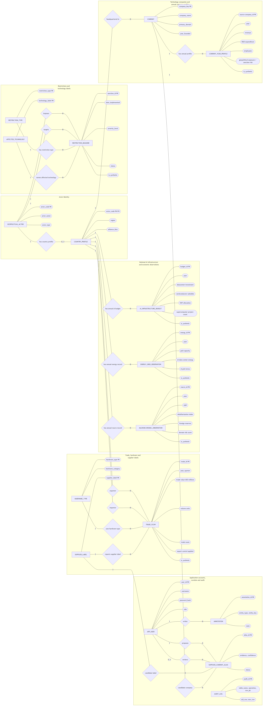

## 8. Relational schema

Source: [RELATIONAL_SCHEMA.mmd](diagrams/RELATIONAL_SCHEMA.mmd). Every table, column, key, constraint and index is listed in the generated [DATA_DICTIONARY.md](DATA_DICTIONARY.md).

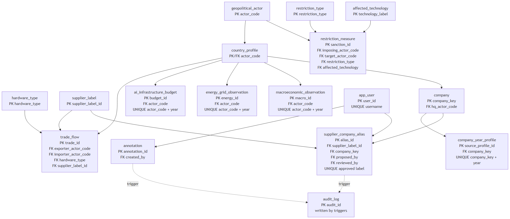

Normalization: repeated labels move into dimension tables (`hardware_type`, `supplier_label`, `restriction_type`, `affected_technology`). `hardware_category` depends only on `hardware_type`, so it lives there (3NF). Country names and regions live once on the actor and profile tables. Derived values such as `year_quarter` are computed in a view. The `raw` schema keeps every source string exactly as delivered.

## 9. Implementation

### SQL

| Assignment item | Where |
|---|---|
| CREATE | `migrations/001`–`003`, `008` |
| ALTER | `migrations/004_alter_constraints.sql`, in real use; also `sql/ddl_demo.sql` |
| DROP | `sql/ddl_demo.sql`, in a throwaway schema so it can never touch project data |
| Primary and foreign keys | All tables |
| Constraints | `NOT NULL`, `UNIQUE`, and `CHECK` on ranges, allowed values and cross-column rules |
| Indexes | `migrations/005_indexes.sql` |
| Views | `migrations/006_views.sql` |
| INSERT, UPDATE, DELETE | Notes, aliases and accounts through the application |
| SELECT with JOIN, GROUP BY, HAVING, ORDER BY, aggregates, subqueries | [QUERIES.md](QUERIES.md) |

### Advanced database concepts

The assignment asks for at least four. All of these exist for a reason in the application and have tests.

| Concept | What it does here | Test evidence |
|---|---|---|
| **Transactions** | A failed import changes nothing. Alias review is all-or-nothing. | `test_bad_source_is_rejected_atomically_and_recorded`, `test_batch_review_is_all_or_nothing`, `test_transaction_rollback_undoes_every_statement` |
| **Views** | Derived `year_quarter`; annual links; country-year comparison; a view that exposes approved aliases only | `test_annual_view_matches_base_table`, `test_alias_stays_out_of_reports_until_approved` |
| **Stored function and procedure** | `actor_exposure()` summarizes an actor. `review_aliases()` applies a batch decision. | `test_exposure_function_matches_hand_written_sql`, `test_procedure_is_all_or_nothing` |
| **Triggers** | An audit trigger logs each change with its author. A guard blocks self-review and non-admin review, which a `CHECK` cannot express. | `test_audit_trigger_records_who_changed_what`, `test_trigger_blocks_self_review`, `test_trigger_blocks_non_admin_review` |
| **Indexing** | Composite, partial and GIN indexes, with plans compared in [QUERIES.md](QUERIES.md) | `test_indexes_are_used_by_their_queries` |
| **Full-text search** | Generated `tsvector` column with a GIN index, ranked search on restrictions | `test_full_text_search_finds_stemmed_terms`, `test_full_text_search_through_api` |
| **NoSQL aggregation** | Cypher computes weighted degree and broker paths for the network | `test_network_aggregation_matches_postgres` |

### Neo4j data model

Source: [GRAPH_MODEL.mmd](diagrams/GRAPH_MODEL.mmd).

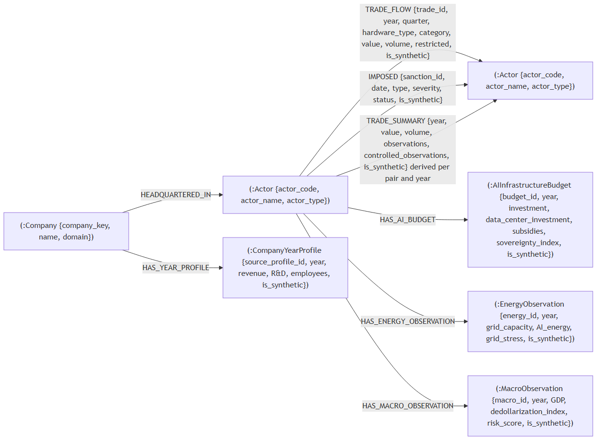

| Item | Detail |
|---|---|
| Nodes | `Actor` (16; 12 also `Country`), `Company` (22), `CompanyYearProfile` (242), `AIInfrastructureBudget`, `EnergyObservation`, `MacroObservation` (132 each) |
| Source relationships | `TRADE_FLOW` (5,656), `IMPOSED` (987), `HEADQUARTERED_IN` (22), `HAS_YEAR_PROFILE` (242), `HAS_AI_BUDGET`, `HAS_ENERGY_OBSERVATION`, `HAS_MACRO_OBSERVATION` (132 each) |
| Derived relationship | `TRADE_SUMMARY` (592), one per directed pair and year |
| Constraints and indexes | Uniqueness on every stable key, including `trade_id` and `sanction_id` on relationships; indexes on relationship `year` |
| Loading | Batched `UNWIND` with `MERGE` on stable keys, so reloading changes nothing; counts are checked afterwards |
| Retrieval | Parameterized Cypher only; traversal depth limited to 4; 5-second query timeout |

No company connects to trade in the graph, because the source does not support that link.

### Integrity and security

| Requirement | How it is met |
|---|---|
| Validation at database level | Types, foreign keys and `CHECK`s; a bad row is rejected even if the API is bypassed |
| Validation at API level | Pydantic types, ranges and patterns; sort columns and metrics come from fixed allow-lists |
| Import integrity | Header, count, key and business-rule checks; reconciliation; one transaction |
| Passwords | Argon2 hashes. A `CHECK` rejects anything else. |
| Credentials | Environment variables only; `.env` is git-ignored; a script generates random secrets |
| SQL and Cypher injection | Bound parameters throughout |
| Least privilege | The API's role cannot modify source facts, run DDL, read staging, or change the audit log. The API container never receives the owner password. |
| Sessions | Signed token in an `HttpOnly`, `SameSite=Strict` cookie; role re-read on each request, so deactivation is immediate |
| Authorization | Checked on the server for each route, and on ownership for notes and aliases |
| Secrets in the browser | A test scans the browser's JavaScript for database secrets and the API address |
| Errors | Clear messages and status codes, with no stack traces or connection details |

Known limits for a course project: there is no login rate limiting, and `COOKIE_SECURE` should be set to true behind HTTPS.

## 10. Important queries

See [QUERIES.md](QUERIES.md) for SQL and Cypher, each with its purpose, its route and its real output. It also compares plans with and without indexes.

## 11. System architecture

Source: [ARCHITECTURE.mmd](diagrams/ARCHITECTURE.mmd), and the import flow in [ETL_FLOW.mmd](diagrams/ETL_FLOW.mmd). Endpoints are listed in [API_CONTRACTS.md](API_CONTRACTS.md).

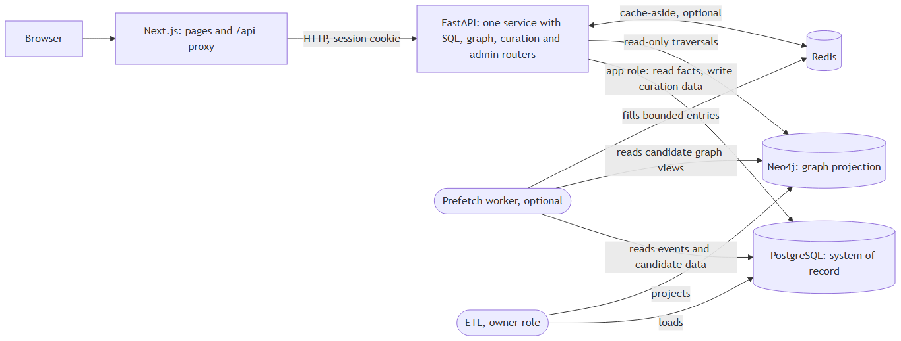

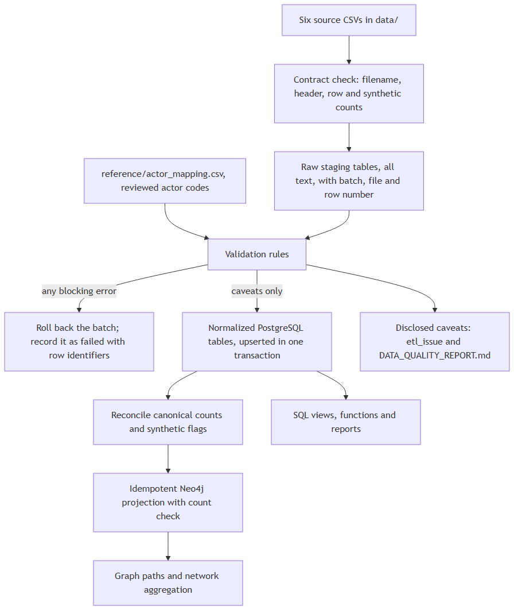

## 12. Application screenshots

Captured by the browser tests against the running application.

| | |
|---|---|
| Overview | 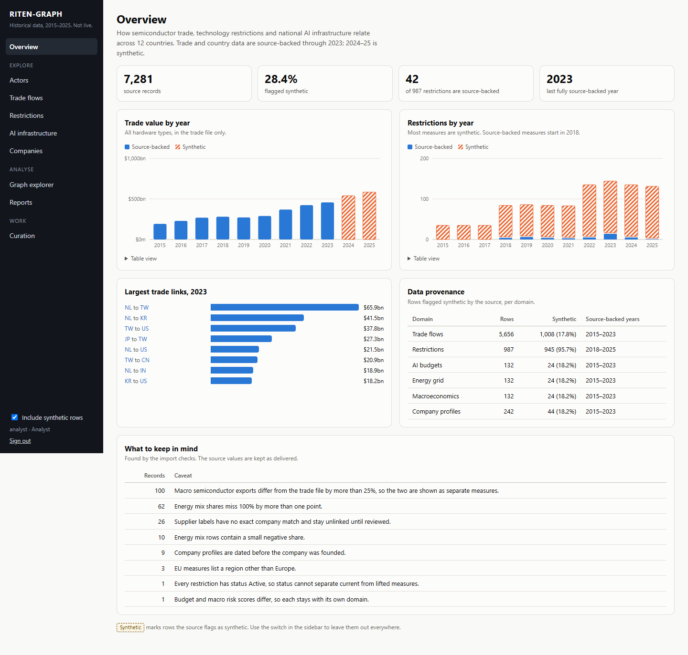 |
| Trade flows | 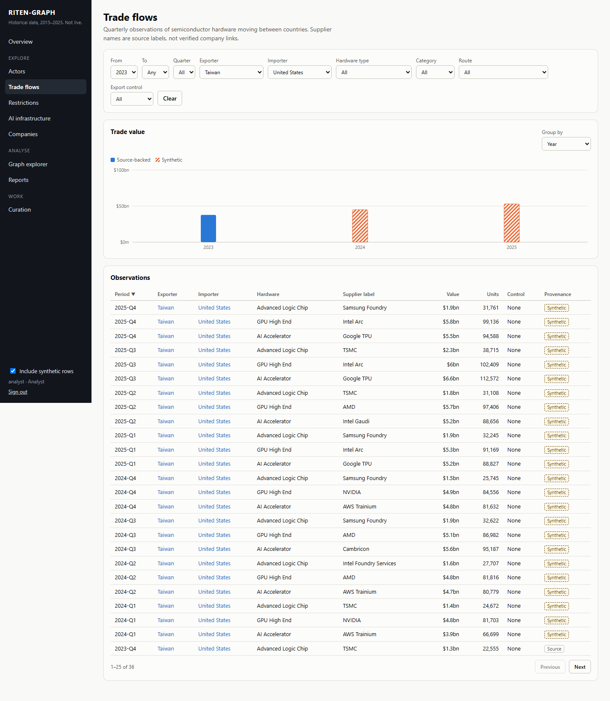 |
| Restrictions with full-text search | 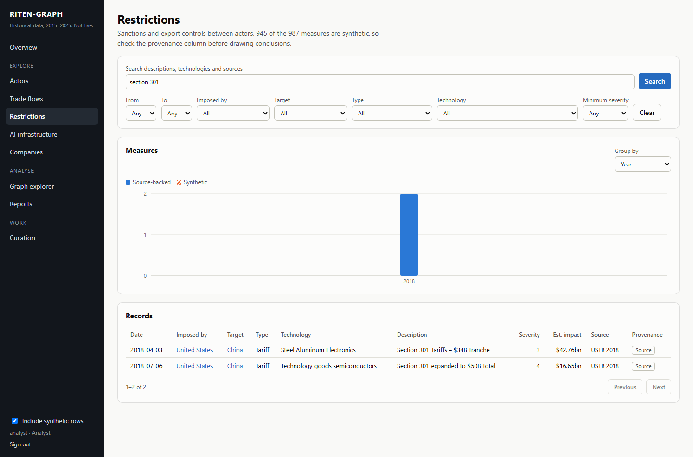 |
| AI infrastructure | 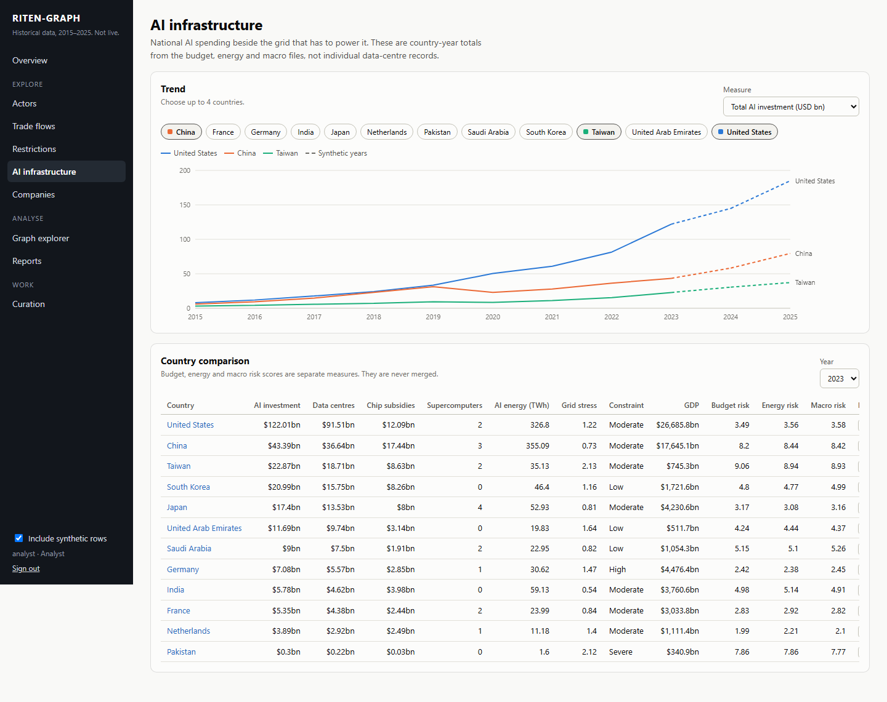 |
| Actor profile | 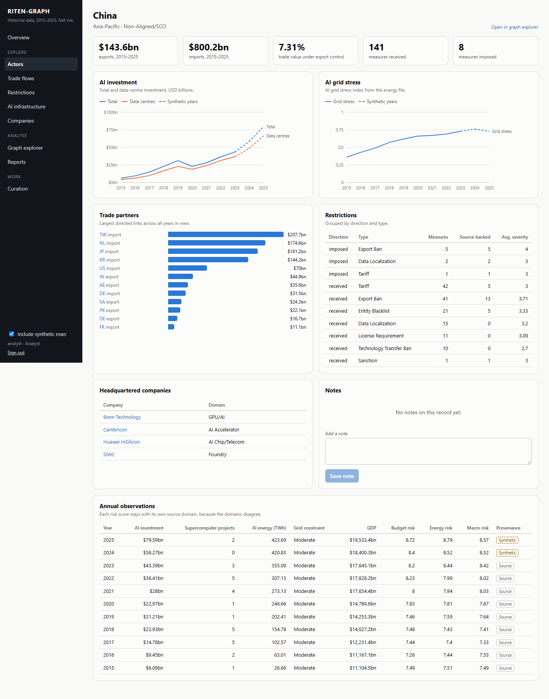 |
| Graph explorer and route analysis | 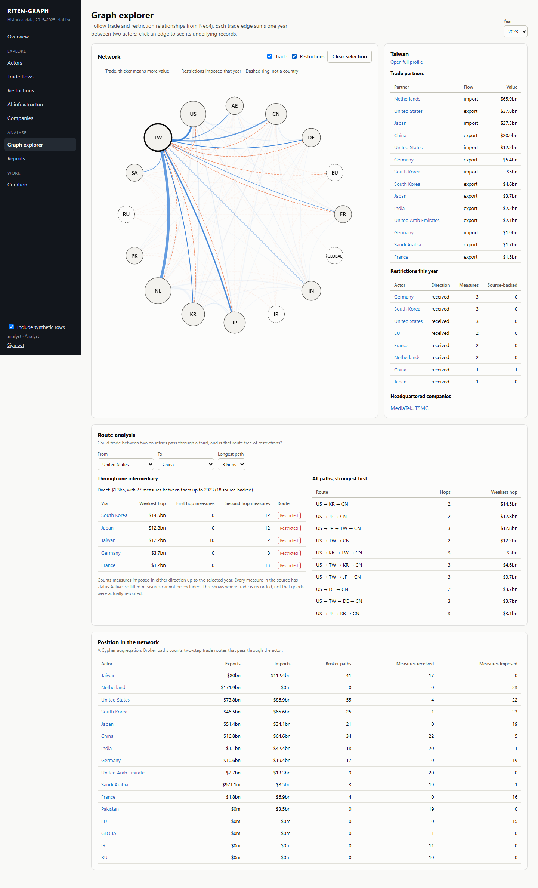 |
| Reports | 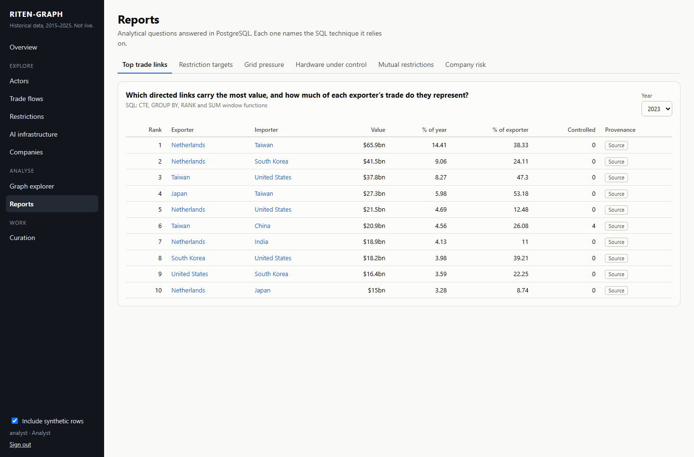 |
| Curation | 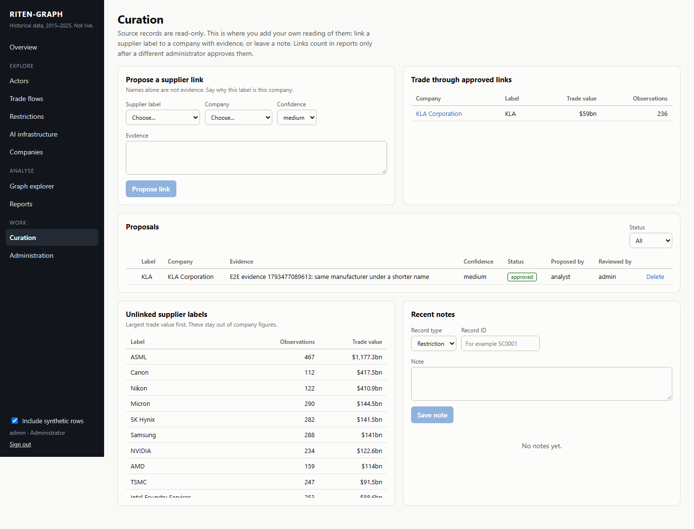 |
| Administration | 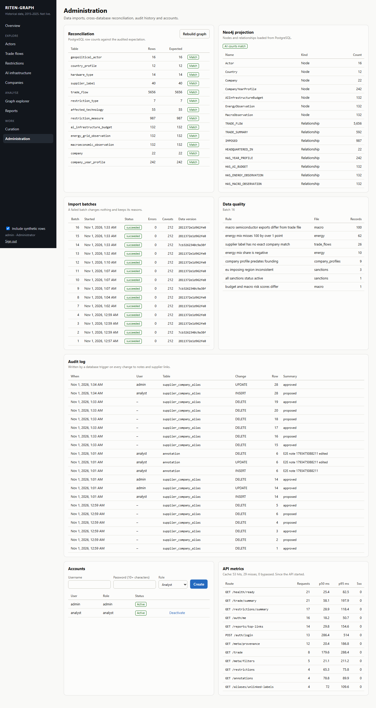 |
| Companies | 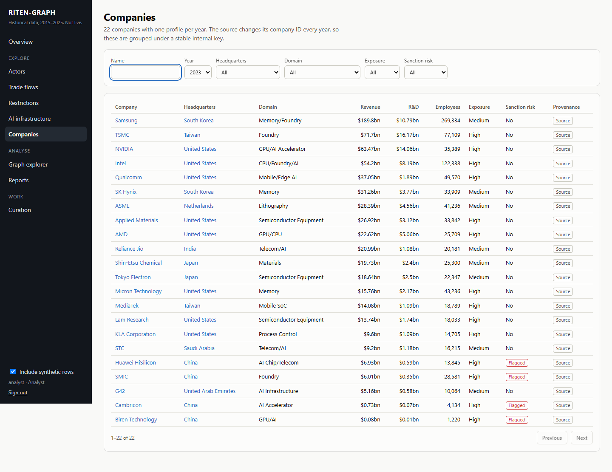 |
| Sign-in | 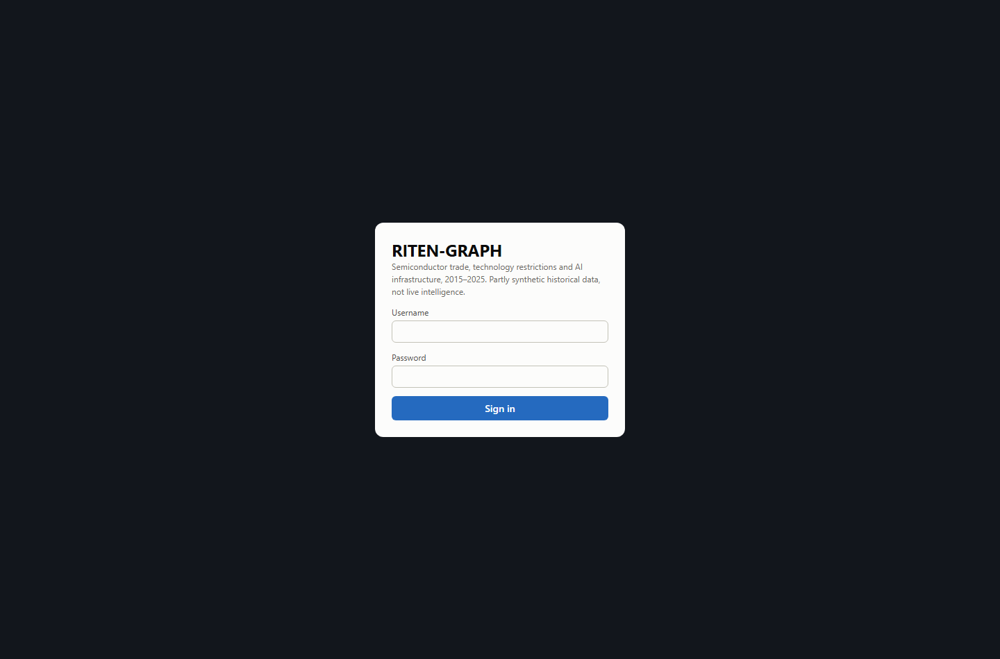 |

## 13. Testing results

All counts below come from the last full run against the Docker Compose stack. Starting that stack from empty volumes was checked separately: migrations, import, seeding and graph projection all completed.

| Suite | What it covers | Tests | Failed |
|---|---|---:|---:|
| `tests/test_etl_unit.py` | Source contract, flag parsing, strict CSV reading, predictor ranking | 14 | 0 |
| `tests/test_database.py` | Exact staging match with the CSVs, canonical counts, values to the cent, constraints rejecting bad data, least privilege, transactions, triggers, procedure, function, views, full-text search, indexes | 74 | 0 |
| `tests/test_graph.py` | Node and relationship counts, idempotent reload, summary edges equal row edges, graph answers equal SQL answers | 20 | 0 |
| `tests/test_api.py` | Sign-in, roles, validation, injection attempts, API results compared with direct SQL, annotations, alias workflow | 104 | 0 |
| `tests/test_cache_and_faults.py` | Cached answers equal uncached ones, TTL, key versioning, dataset replacement, outages, query timeouts, prefetch budget and usefulness | 33 | 0 |
| **Backend total** | | **245** | **0** |
| `frontend/e2e/app.spec.ts` | Browser to database: sign-in, filters, synthetic switch, search, graph, reports, roles, the full alias approval flow, notes, no secrets in browser code | 15 | 0 |

Tests run against real PostgreSQL, Neo4j and Redis. A few outage tests use mocks for failures that are hard to trigger on demand.

Testing changed the code. These problems were found and fixed:

- Stopping the real Neo4j container returned a 500, because the driver raised a plain `ValueError` when the host name stopped resolving. Mocked tests had missed it. It now returns a 503, with a regression test using an unreachable host.
- The benchmark's correctness check found one response that differed from the no-cache answer. The likely cause was rows with tied sort values coming back in a different order, so every list now has a full tie-break. The next run found 0 differences.
- A dropdown's label included its options' text, which made its accessible name unreliable. Labels are now separate elements.

## 14. Performance and failure behaviour

Full figures are in [BENCHMARKS.md](BENCHMARKS.md), and failure behaviour in [FAULT_TESTS.md](FAULT_TESTS.md). These are single runs on one laptop using simulated navigation, so small differences are noise.

| Finding | Evidence |
|---|---|
| **The cache helps repeat views most.** | Busy traffic: median view latency fell from 74 ms to 33 ms at a 76% hit rate. Multi-query pages gain most: the actor profile fell from 113 ms to 30 ms. |
| **Single-query SQL hardly benefits.** | Trade summary and top links stay within noise at about 35–40 ms, probably because the session check on each request already costs a database round trip. Tail latency in the busy run was not better either: p95 went from 116 ms to 177 ms, likely from the few cache misses in that small sample. |
| **Adaptive prefetch beat the static baseline on hit rate, at a real cost when traffic is sparse.** | Busy: 87.5% vs 82.3%. Sparse: 64.6% vs 54.2%, with 50% of prefetches used vs 38%. Even so, 210,784 of 500,516 prefetched bytes were wasted in the sparse run. |
| **The prefetch result is favourable by construction.** | The simulated walk follows habits 70% of the time. Real users may be less predictable. |
| **Answers stayed correct.** | No navigation response or endpoint differed from the no-cache answer. |

**Decisions.** Redis is enabled in the Compose stack because the application still works without it. The prefetch worker stays optional and off by default: it adds a moving part and wasted work for a modest gain on a dataset this small. The service split was not built (decision 17). A Neo4j outage already leaves SQL pages working in one process, so it would add operations without adding that isolation.

**Failures.** All 9 live scenarios passed, covering stopping and restarting Redis, Neo4j, PostgreSQL and the worker. With Neo4j down, SQL pages keep working and uncached graph requests get a clear 503. With Redis down, everything answers from the databases. With PostgreSQL down, signed-in requests get a controlled 503 after about 5 seconds, since sessions are checked against it. Each service recovers without restarting the API.

## 15. Assignment compliance

| Clause | Requirement | Evidence | Status |
|---|---|---|---|
| 1 | Unique title; real problem; beyond CRUD | Sections 1 and 4 | Done; uniqueness within the section is for the team to confirm |
| 2 | Two-member team, defined responsibilities | README Team section | **Team to complete** |
| 3 | SQL plus NoSQL | PostgreSQL and Neo4j, both used by real pages | Done |
| 4 | ER diagram, relational schema, NoSQL data model | Sections 7, 8, 9 | Done |
| 5 | DDL: CREATE, ALTER, DROP, keys, constraints, indexes, views | Section 9 | Done |
| 6 | DML and meaningful queries | Section 9, QUERIES.md | Done |
| 7 | At least four advanced concepts | Seven, in section 9 | Done |
| 8 | Vector search (optional) | Not used; decision 16 | Deliberate choice |
| 9 | Next.js interface | Section 12 | Done |
| 10 | Backend layer; no hard-coded credentials | Sections 9 and 11 | Done |
| 11 | Authentication; at least two roles | Analyst and Administrator | Done |
| 12 | Database-level validation; integrity | Section 9 | Done |
| 13 | Security; no plain-text credentials | Section 9 | Done |
| 14 | Documentation | This report and linked documents | Done |
| 15 | Git/GitHub; individual commits; README | Local Git history and README | **Team to complete:** push to GitHub; history must show both members |
| 16 | Demonstration | Section 16 | **Team to deliver** |
| 17 | Original design and implementation | Project-specific model and code | **Team to confirm** with the instructor; see the note below |
| 18 | Beyond CRUD; justified database choices | Sections 1, 5, 9 | Done |

**Note on originality and contribution.** This implementation was built with an AI coding assistant, working from the team's project guide. The assignment expects original work with individual contributions, so the team should check the course's rules on AI assistance and be ready to explain every part in the demonstration.

## 16. Demonstration outline

1. Problem and motivation, and why this is more than CRUD (section 1).
2. ER diagram and schema; actor identity, annual observations and synthetic flags (sections 6–8).
3. Admin page: reconciliation against the source, and the quality caveats.
4. Run `sql/ddl_demo.sql`; open QUERIES.md for important queries.
5. Graph explorer: select Taiwan, then run route analysis from the United States to China. Explain why Neo4j suits this.
6. Curation: as analyst, propose KLA → KLA Corporation; as admin, approve it; show it in company figures and in the audit log.
7. Try to break it: an analyst opening Administration, an admin approving their own proposal, and the synthetic switch emptying a 2024 view.
8. Run the tests. Stop Neo4j and show SQL pages still working.
9. Team members explain their contributions.

## 17. Conclusion and future enhancements

RITEN-GRAPH shows that the two databases solve different parts of one problem and can be kept consistent, with PostgreSQL as the record and Neo4j as a checked projection. The largest lesson came from the data: the honest finding that most restrictions are synthetic shaped the interface as much as the schema shaped the queries.

Future work:

- Replace synthetic restrictions and the 2024–25 estimates with sourced records, and add real end dates so "Active" means something.
- Curate more supplier aliases, then project approved ones into the graph for company-level supply paths.
- Resolve IR and RU against an authoritative country list, recording the evidence.
- Add login rate limiting and HTTPS for any shared deployment.
- Consider semantic search if longer source-backed policy text is added.
